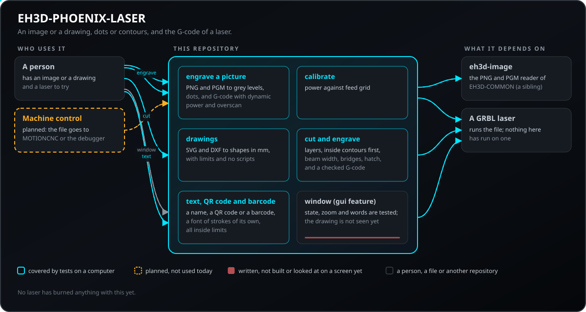

<p align="center">
  
</p>

#  EH3D-PHOENIX-LASER
<p align="center"><a href="README.md">🇺🇸 English</a> | <a href="README_spa.md">🇪🇸 Español</a> | <a href="README_fra.md">🇫🇷 Français</a> | <a href="README_ita.md">🇮🇹 Italiano</a> | <a href="README_deu.md">🇩🇪 Deutsch</a> | <a href="README_zho.md">🇨🇳 中文</a> | 🇯🇵 <b>日本語</b> | <a href="README_por.md">🇵🇹 Português</a></p>

### 画像からのレーザー彫刻と図面からの切断：ディザリング、ラスター G コード、SVG・DXF の輪郭、キャリブレーション格子

<p align="center">
  
  
  
  
  
</p>

---

**正直さの確認 - 現在実際に動くもの：**Rust のライブラリとコマンドラインプログラム（`phoenix-laser`）で、コンピューター上で動く 1055 件のテストがあります。画像をディザリングでドットにして、ダイナミック出力とオーバースキャンで 1 行ずつ焼くレーザーの G コードを書き、SVG・DXF・LBRN2 の図面を読み、その輪郭を切る G コード（内側の輪郭が先、ビーム幅を考慮、ブリッジ、複数パス）を書き、図形を線で彫刻します。各レイヤーの設定はファイルに置きます。文字、QR コード、バーコードも焼き、プログラムをマシンの上限に照らして検査し、出力と送りのテスト格子を書きます。ウィンドウ（`--features gui` でビルド）はスイートのドッキングフレームで、12 のパネルと 4 つのワークスペースがあり、画像や図面を開き、レーザーの経路を表示し、設定を変更でき、G コードを書き出します。ウィンドウは、人が画面で確認したことがありません。LBRN2 プロジェクトのリーダーはレーザーメーカーの実在する 12 のプロジェクトで測定しました（12 件とも読め、その中の唯一の画像はデコードされてドットとして彫刻されます。y 軸の向きは実際の部品で確認されたことがありません）。プログラムを EH3D サーバーのレーザープラグインへ送り、ジョブを追跡・保留・停止することもできます（`phoenix-laser server`）が、サーバーの代役に対してのみテスト済みです。**ここにあるものは実際のレーザーで実行されたことがありません**。これらのプロジェクトやほかのものから作ったものを、機械で切ったり焼いたりしたこともありません。

---

> **安全とセキュリティの状況：** このプログラムは自分では機械を制御せず、安全システムでもありません。G コードを書き、検査し、EH3D サーバーのレーザープラグイン（現時点ではシミュレーター）へ送ることができます。出力は、機械で何かを実行する前に人が確認する必要があります。ここにあるものは実機で動かしたことがありません。


## 📋 ひと目で

| | |
|---|---|
| バージョン | `0.1.6` |
| 成熟度 | 機能する |
| テスト | 1055 |
| 技術スタック | Rust |
| 実機での動作 | 未試験：ここにあるものは機械で動かしたことがありません |

**移動先：** [概要](#-概要) · [アーキテクチャ](#-アーキテクチャ) · [クイックスタート](#-クイックスタート) · [テスト](#-テスト) · [構成](#-リポジトリの構成) · [関連](#-関連プロジェクト)

## 🚦 プロジェクトの状況

各行はこのリポジトリの一部分で、信号は今日どこまで進んでいるかを示します。計画ではなく、リポジトリが示せるもの（テスト、ビルド、実行）に基づいて書かれています。

🟢 完了・検証済み · 🟡 動作する（既知の制限あり） · 🟠 一部のみ、または未検証 · 🔴 未実装または動作しない

| 領域 | 状態 | ここでの意味 |
|---|---|---|
| コア | 🟡 | 画像をディザリングで点に変換し、動的出力とオーバースキャンで1行ずつ照射するレーザーの G コードを書き、SVG と DXF の図面を読んでレイヤーごとに切断または彫刻し（輪郭の順序、ビーム幅、タブ、パス、ハッチ）、出力対送り速度のテスト格子も作ります。コンピューター上で通常入力と壊れた入力を使ってテスト済みで、実際のファイルの集まりでは確認していません。 |
| コマンドライン | 🟡 | `phoenix-laser`（`engrave`、`calibrate`、`info`、`cut`、`vector`、`layers`）はライブラリと同じ関数を実行して結果を表示します。エラーはすべてメッセージと 0 以外の終了コードで返ります。 |
| テスト | 🟡 | 1055 件のテストが通ります（`cargo test`）。通常ケース、境界ケース、破損入力を含みます。 |
| セキュリティ | 🟡 | 安全な Rust のみ（`forbid(unsafe_code)`）。受け取ったファイルでパニックせず、不正な値は理由付きのエラーになります。独立したレビューはありません。 |
| ウィンドウ | 🟠 | スイートのドッキングフレームとして作成済み（egui、`--features gui`）：画像または SVG・DXF・LBRN2 の図面を開く／ドロップする、レーザーの経路（切断は1色、移動は薄く）を見る、レイヤーの表を編集する、文字・QR コード・バーコード・マーク・枠・フォーカスの各モード、キャリブレーション格子、拡大縮小と移動、時間の見積り、検査、レポート、サーバーへの送信、書き出し。ロジックはテスト済みですが、人が画面で確認したことはありません。 |
| 実機 | 🔴 | 未試験：ここにあるものは機械で実行したことがありません。 |
| ドキュメント | 🟡 | 8 言語の README、変更履歴、`docs/` から描いた 2 枚の図。 |

## 🎯 概要

* **画像**（`eh3d-image`）：PNG（グレー、カラー、透明、8 または 16 ビット）と PGM（テキスト、バイナリ）を濃淡に変換し、透明部分は白として扱い、悪意あるファイルがギガバイトを要求できないようサイズを制限します。`resize` は画素を平均し、1 点をビーム径の大きさにします。
* **点**（`src/dither.rs`）：しきい値、または Floyd-Steinberg か Atkinson の誤差拡散。テストで、灰色の濃さが保たれること（中間の灰色は約半分の点を焼く）、白は何も焼かず黒はすべて焼くことを確認します。
* **レーザー**（`src/raster.rs`、`src/calibrate.rs`）：1 行ずつ、左から右、次は右から左へ、移動中は `M4` と `S0`、焼く所では選んだ出力、固定または加速度から求めたオーバースキャン（v の 2 乗を 2a で割る）、そして材料に合う値を探すための、列ごとに出力・行ごとに送りを変えた正方形の格子。
* **すべての G コードファイルのヘッダーと数値**（`src/gcode_out.rs`）：ファイルの先頭にコメント行があり、生成元とそのバージョン、単位（mm、G21）、元の画像とその SHA-256、工具（レーザーと出力）が書かれます。校正グリッドには元がないと書かれます。数値の書き方は一つだけ（小数は最大 3 桁、`-0` なし）で、有限でない値は `NaN` や `inf` として書かれずに拒否されます。
* **`--dry-run`：** `engrave` は結果を計算して集計し（ドット、行、走査、焼く長さ、時間）、出力ファイルは書き出しません（その場合は省略できます）。
* **図面**（`src/svg.rs`、`src/dxf.rs`、`src/flatten.rs`、`src/vector.rs`）：SVG の安全なサブセット（すべてのコマンドのパス、図形、変換、グループ、単位、同じファイル内の要素への `use`）と DXF のエンティティ（線、円弧つきポリライン、円弧、円、楕円、スプライン、挿入つきのブロック、単位）をミリメートルの図形にします。スクリプト、画像、別のファイルへの `use`、宣言されたエンティティ、未知のものは無視または拒否され、サイズ、深さ、要素数（`use` が取り込む分も数えます）と点数は設定で制限され、自分自身に戻る `use` はエラーで、曲線は許容差内の直線に分割されます。
* **切断と彫刻**（`src/order.rs`、`src/offset.rs`、`src/cut.rs`）：図形はレイヤー（DXF）または色（SVG）でまとめられ、各グループはそれぞれの設定で切断（ばらばらの線を結合、他の輪郭の内側を先に、移動が最短、ビーム幅を正しい側で差し引き、タブを残し、焦点を進めながら複数パス）または彫刻（閉じた図形を角度つきの線で塗りつぶし、偶奇規則）されます。`phoenix-laser layers DRAWING --accel A` は、ヘッドがすべてのコーナーで `A` mm/s2 で減速・加速するものとして、各レイヤーの所要時間（そのうちレーザーが焼く時間も）をプログラムのプレビューと同じ方法で表示します。
* **設定ファイル**（`src/vconfig.rs`、`docs/vector-settings.md`）：調整するすべての値（リーダーの上限、機械、各レイヤーの設定）は1行ずつ検証されるプレーンテキストにあり、コードには何も入っていません。
* **焦点テスト**（`src/calibrate.rs`、設定ファイルの `[focus]`）：`phoenix-laser focus` は、ヘッドの高さを変えながら短い線を階段状に焼き、最も鮮明な線でビームの焦点位置を示します。高さのステップには既定値がなく（下がどちらかは機械によります）、出力は出力の上限に従い、ヘッドは最初の高さに戻ります。`--powers 10,20,30`（最大10種類の出力）を付けると、代わりにフォーカスのグリッドを焼きます。同じ線を出力ごとに1列ずつ並べるので、焦点の高さで最も細い線を焼く出力を読み取れます。ヘッドは各高さへ1回だけ移動してその行のすべての列を焼き、どの出力も出力の上限に従います。
* **材料の試験グリッド**（`src/calibrate.rs`、設定ファイルの `[calibrate]`）：`phoenix-laser calibrate --material 名前 --materials ファイル` は、ライブラリの材料が示す値のまわりにグリッドのパワーと速度を、上限の範囲内で重複なく振り分けます。`--labels` は各列のパワーと各行の速度を、ストローク書体で四角の横に焼き付けるので、あとから材料の上でグリッドを読めます。上限を超える材料は拒否され、下げられることはありません。 材料を使うと数字は既定で焼き付けられ（`--no-labels` で外せます）、階段の最小パワーと最小送り速度はキー `min_power_percent` と `min_feed_mm_min` です。
* **テキスト**（`src/text.rs`、設定ファイルの `[text]`）：`phoenix-laser text OUT.nc --text TEXT` は、プログラム独自のストローク書体（大文字、数字、スペース、`. , - + / : ! ? ( ) = _ '`。小文字は大文字として、改行は新しい行として焼き付けます）で名前、シリアル番号、マークを焼き付け、フォントファイルは不要です。大文字の高さ、文字と行の間隔、パワー、送り速度、回数は設定です。書体にない文字、`max_chars` を超える文字数、`max_height_mm` を超える高さ、上限を超えるパワーや送り速度、ベッドの外に出る作業は拒否され、切り詰められることはなく、テキストがプログラムのコメントに書かれることもありません。複数行のテキストの各行は左・中央・右に揃えられ（`--align`）、ガラスやアクリルの裏面用に鏡像で焼くことができ（`--mirror`）、`max_minutes` を超える時間がかかる焼き付けは拒否されます。
* **QR コード**（`src/qr.rs`、設定ファイルの `[qr]`）：`phoenix-laser qr OUT.nc --text データ` は、データをプログラム独自の QR コード（バージョン1〜4、1辺21〜33モジュール、バイトモード、リード・ソロモンによる4段階の誤り訂正、ペナルティが最小のマスク）として、暗いモジュールを線で塗りつぶして焼き付けます。このシンボルは、全バージョン・全レベルで独立したデコーダーで読み戻して確認しており、テストも自前のリーダーで読み戻します。モジュールの一辺、線の間隔、レベル、出力、速度、パス数、上限は設定です。`max_bytes` を超えるデータ、`max_version` を超えるバージョン、`max_size_mm` より大きいシンボル、`max_lines` を超える移動の塗りつぶし、上限を超える出力や速度、ベッドの外になる作業は、切り詰めも縮小もせずに拒否され、データがプログラムのコメントに書かれることはありません。`--print` でシンボルをテキストで表示します。いずれも既定ではオフです。`--invert` は代わりに明るいモジュールを焼き（`--border-modules` で周囲に焼いた縁を付けられます）、`--mirror` はガラスやアクリルの裏面用に鏡像を焼き、`--overscan-mm` はレーザーを消した状態でヘッドを各線の手前から先まで走らせ（ベッドの外に出る場合は拒否）、`max_minutes` を超える時間がかかる焼き付けは拒否されます。
* **バーコード**（`src/barcode.rs`、設定ファイルの `[barcode]`）：`phoenix-laser barcode OUT.nc --text データ` は、データをプログラム独自の Code 128 バーコード（スペースから `~` までの文字はセット B、偶数桁の数字だけの文字列は幅が半分のセット C で、チェックシンボル付き）として、各バーを高さ方向の線で塗りつぶして焼き付けます。テストは自前のリーダーで読み戻しますが、スキャナーでの読み取りはまだ確認していません。最も細いバーの幅、高さ、線の間隔、出力、速度、パス数、上限は設定です。印字できない文字のバイト、`max_chars` を超える文字数、`max_width_mm` より広いバーコード、`max_lines` を超える移動の塗りつぶし、`max_minutes` を超える時間がかかる焼き付け、上限を超える出力や速度、ベッドの外になる作業は、切り詰めも縮小もせずに拒否され、データがプログラムのコメントに書かれることはありません。`--mirror` はガラスやアクリルの裏面用に鏡像を焼きます。
* **クロスハッチ**（`src/cut.rs`、レイヤーの `hatch_cross`）：`hatch_cross = on`（または `vector` と `trace` の `--cross`）の `engrave` レイヤーは、同じ間隔で最初の線と直角の線で、各パスごとに二度目の塗りつぶしをします。線数の上限は各組に適用され、レイヤー一覧が示す 1 平方ミリメートルあたりのエネルギーは 2 倍になり、プレビューとプログラムの検査は他のプログラムと同じように扱います。
* **作業のフレーム**（`src/frame.rs`、設定ファイルの `[frame]`）：`phoenix-laser frame` は、サイズまたは G-code プログラムが焼く範囲から、レーザーを消したまま作業範囲の長方形をなぞるプログラムを書き、どこに載るかを確認できます。弱いパイロット出力は毎回 `--confirm-laser-on` が必要で、上限は 5 %（`[frame]` の `max_pilot_percent` で変更できます）、出力の上限にも従い、ベッド外のフレームは拒否されます。
* **位置合わせマーク**（`src/frame.rs`、設定ファイルの `[marks]`）：`phoenix-laser marks OUT.nc --size W,H` は、作業の長方形の四隅（辺の上、または `margin_mm` だけ外側）に L 字を、`--centre-cross` を付けると中央に十字を、弱い出力で焼き付けます。材料を同じ位置に戻したり、2 つ目の作業を 1 つ目に合わせたりするためのものです。レーザーを消すフレームと違い、マークは焼かれるため、出力と速度は機械の上限に従い、長方形の一辺の半分より長い腕や、ベッドの外に出るマークは、切り詰めずに拒否されます。腕の長さ、余白、出力、速度、パス数は設定です。`phoenix-laser align PICTURE.pgm --size W,H --px-per-mm S` は、真上から撮ったベッドの画像からマークを見つけ、本来の位置からどれだけずれているか（作業の原点に加えるずれと回転）を示します。マークが欠けている、遠すぎる、または回転が大きすぎる画像は拒否します。`--simulate` が描いた画像でしか試しておらず、実際のカメラでは試していません。
* **プレビュー**（`src/preview.rs`）：`phoenix-laser preview` は G-code プログラム（自作のものでも他のものでも）を読み、移動、焼いた長さと移動した長さ、範囲、出力、角での減速を数えた時間を表示します。危険に見えるもの（早送り中のレーザーオン、送り速度なし、全出力超えの値、ベッド外の作業、終了なし）を警告し、経路を SVG で描きます。テストは彫刻が書いたものを読み戻して同じ長さを確認します。`--laser-watts W`（フル出力時のレーザーの出力）を付けると、各移動の出力を `--smax` に対する割合として照射時間にかけ合わせた、プログラムが焼き付けるエネルギーと、その平均出力も表示します。
* **素材ライブラリ**（`src/materials.rs`、`examples/materials.cfg`）：素材と加工方法ごとに合う値（`[material 名前]`：出力、速度、パス数、焦点ステップ、ビーム幅、ハッチ、ドットの大きさ、ディザリング、トーンカーブ）を 1 つのテキストファイルに書き、`--material 名前 --materials ファイル` で選びます。コマンドラインのオプションが優先し、出力の上限は両方に対して有効です。`phoenix-laser materials ファイル` でライブラリを一覧できます。
* **出力の上限**（`src/safety.rs`、`[machine]` の `max_power_percent`、`--max-power`）：出力が上限を超えるプログラムは、レイヤーまたはオプションを示すエラーで拒否され、黙って下げられることはありません。ファイルかオプションが指定するまで上限は 100 % です。
* **マシンプロファイル**（設定ファイルの `[profile NAME]`、`--profile NAME`）：2 台のマシンを持つ人や、レーザーモジュールを交換する人は、それぞれにプロファイルを持てます（ベッドの移動量、出力の上限、速度の上限、フルパワーの値、ワット数）。選んだプロファイルがマシンになり、`--max-speed` は `--max-power` と並んで働きます。上限を超える速度は拒否され、黙って下げられることはありません。
* **画像からの輪郭**（`src/trace.rs`、設定ファイルの `[trace]`）：`phoenix-laser trace` は、ロゴやシルエットやステンシルを 1 ドットずつ焼く代わりに、その輪郭をたどります。グレーレベルをしきい値で分け、サブピクセル精度の marching squares で境界を見つけ、どの点も線から `simplify_mm` 以上離れなくなるまで単純化し、小さなゴミは捨てます。結果は図面の 1 つのレイヤーで、同じ設定と同じ検査で切断（または線で塗りつぶし）され、画像サイズ、境界の断片、輪郭、点の数はすべて制限されています。
* **ウィンドウでのトーン、素材、上限**（`src/window.rs`）：トーンカーブのボックス（ガンマ、コントラスト、明るさ、反転、自動レベル）は、コマンドラインと同じ関数で画像を処理します。素材ライブラリはファイルから読み込まれ（または `PHOENIX_LASER_MATERIALS` で指定）、素材を選ぶと出力、速度、ドット、ディザリング、トーン、図面の各レイヤーのボックスが埋まります。出力と速度の上限もボックスで、それを超える値は拒否され、下げられることはありません。初期値は設定ファイル（`[tone]`、`[machine]`）から取られます。
* **ウィンドウでの材料の編集**（`src/window.rs`、`src/materials.rs`）：材料のセクションで、材料の編集、コピー、入力欄（出力、速度、ドット、オーバースキャン、ディザリング、トーンカーブ）からの作成、削除ができ、新しいライブラリも作れます。ファイルの各キーに対応する欄に値を入れ、保存するとその材料のセクションがその場所で書き直され（新規なら末尾に追加され）、コメント、空行、順序、改行コード、ほかの材料には手を触れません。範囲外の値、空・長すぎる・使用済みの名前、UTF-8 でない、または有効なライブラリでないファイルは、キー名を示して拒否され、ファイルはそのままで、値は決して切り詰められません。削除は 2 回目の押下が必要で、新しいライブラリは既存のファイルの上には書き込まれません。
* **ウィンドウでのフォーカステスト**（`src/window.rs`）：`[focus]` セクションのボックス（最初の線の高さ、刻み、線の数と長さ、間隔、速度、出力）を持つモードです。テストは `phoenix-laser focus` と同じ関数で計算され、出力と速度は上限に従い、下がどちらかは機械によって決まるため既定の刻みはなく、テストが Z を動かすという警告がメモに残ります。 格子の出力を入れる欄（最大 10 個、カンマ区切り）があると、ウィンドウは `focus --powers` の焦点グリッドを焼き付けます。出力ごとに 1 回ずつ線を引き、出力ごとに 1 列になります。そのとき単一の出力の欄は使われず、0 を超え 100 以下でない出力、上限を超える出力、多すぎる出力は拒否されます。
* **ウィンドウでの文字**（`src/window.rs`）：文字列のボックスと `[text]` セクションのボックス（大文字の高さ、最大の文字高、文字と行の間隔、出力、速度、パス数、最大文字数）を持つモードです。文字列は `phoenix-laser text` と同じ関数で機械の原点から計算され、フォントにない文字、上限を超える文字列、機械の上限を超える出力や速度、ベッドの外になる作業（設定ファイルが指定している場合）は拒否され、ステータス行が理由を示します。コマンドラインと同じヘッダー付きで `text.nc` として書き出されます。行の揃え、鏡像のスイッチ、最長時間もウィンドウから設定できます。
* **ウィンドウでの QR コード**（`src/window.rs`）：データのボックス、誤り訂正レベルの選択、`[qr]` セクションのボックス（モジュールの一辺、線の間隔、出力、速度、パス数、最大バイト数、最大のバージョンと一辺、最大の焼き付け移動数）を持つモードです。シンボルは `phoenix-laser qr` と同じ関数で機械の原点から計算され、収まらないデータ、上限を超えるシンボル、機械の上限を超える出力や速度、ベッドの外になる作業（設定ファイルが指定している場合）は拒否され、ステータス行が理由を示します。コマンドラインと同じヘッダー付きで `qr.nc` として書き出されます。反転と鏡像のスイッチ、縁・助走・最長時間のボックスもウィンドウにあります。
* **ウィンドウでの位置決めマーク**（`src/window.rs`、設定ファイルの `[marks]`）：長方形の大きさ、各 L の腕の長さ、余白、出力、速度、パス数の入力欄と、中央の十字のスイッチを持つモードです（設定ファイルが `[marks]` の欄を埋めます）。マークは `phoenix-laser marks` と同じ関数でマシンの原点から計算され、辺の半分より長い腕、上限を超える出力や速度、ベッドの外のマークは拒否され、ステータス行に欄または理由が示されます。いつものヘッダー付きで `marks.nc` として書き出されます。
* **ウィンドウでの Code 128 バーコード**（`src/window.rs`、設定ファイルの `[barcode]`）：データの入力欄、鏡像のスイッチ、`[barcode]` の欄（最も細いバーの幅、高さ、線の間隔、出力、速度、パス数、上限。設定ファイルが埋めます）を持つモードです。バーコードは `phoenix-laser barcode` と同じ関数でマシンの原点から計算され、印字可能な文字でないデータや長すぎるデータ、上限を超えるバーコード、マシンの上限を超える出力や速度、ベッドの外の作業は拒否され、ステータス行に欄または理由が示されます。いつものヘッダー付きで `barcode.nc` として書き出されます。
* **ウィンドウでのフレーム**（`src/window.rs`、設定ファイルの `[frame]`）：開いている画像や図面を、レーザーを消したまま囲むモードです。余白、周回数、速度はボックスです。0 より大きいパイロット出力はレーザーを点灯するため、ウィンドウが確認し、利用者が「はい」と答えるまで何も計算も書き出しもされません。これは毎回必要で（ボックスの変更、モードの変更、ファイルの書き出しで回答は取り消されます）、`max_pilot_percent` の上限、出力の上限、ベッドの範囲の内側でのみ有効です。
* **ウィンドウでのプレビュー**（`src/window.rs`）：ウィンドウが計算する G-code はすべて `phoenix-laser preview` と同じプレビューで集計されます（移動回数、焼いた長さと移動した長さ、ボックスの加速度で角を数えた時間、設定ファイルのベッドの外に出る作業など危険に見えるもの）。出所を問わない G-code プログラム（`.nc`、`.ngc`、`.gcode`、`.gc`、`.tap`）も、開くかウィンドウにドロップして経路とメモを確認できます。テキストとして読むだけで、実行も再書き込みもされません。 レーザーの出力は入力欄に書き込めます（設定ファイルとマシンプロファイルが `laser_watts` から埋めます。0 は不明を意味します）。プレビューは、`phoenix-laser preview --laser-watts` と同じように、プログラムが焼き付けるエネルギーと平均出力も表示し、0 から 1000 の数でない値は拒否されます。
* **ウィンドウでの輪郭**（`src/window.rs`、設定ファイルの `[trace]`）：開いている画像の輪郭を `phoenix-laser trace` と同じ関数でたどり、`trace` という名前のレイヤーとして切断するか、その形を線で塗りつぶすモードです。ボックスはしきい値、簡略化、最小の部分で、明るい部分をインクにするスイッチがあります。パワーとスピードはレーザーのボックスのものでありリミットに従い、画像の制限（`max_pixels`、`max_contours`、`max_segments`）は設定ファイルのものなので、細かすぎる画像は遅いプログラムではなくエラーになります。
* **ウィンドウでのマシンプロファイル**（`src/window.rs`、設定ファイルの `[profile NAME]`）：サイドパネルにファイルのマシンの一覧があり、選んだものが `--profile` と同じようにマシンになります。フル出力の値と、パワーおよび速度の上限のボックスがその値になり、プロファイルのベッドがフレームとプレビューの確認対象になります。プロファイルが省いた項目は `[machine]` から取られ、ファイルにないプロファイルは何も変えず、上限は引き続きそれを超えるパワーや速度を拒否します。
* **ウィンドウでの材料からのグリッド**（`src/window.rs`、設定ファイルの `[calibrate]`）：校正モードはライブラリの材料を一覧表示します。材料を選ぶと、`phoenix-laser calibrate --material` と同じ階段でそのパワーと送り速度の周りにグリッドを広げ（段数、幅、最小パワーと最小送り速度のボックスがあり、それらと上限の間に収まります）、スイッチでボックスの高さの数字を四角の横に焼き付けます。何も選ばなければ、従来どおり二つのリストのグリッドです。
* **ウィンドウでのプログラムの検査**（`src/window.rs`、設定ファイルの `[verify]`）：見るために開いた G-code プログラムは、ウィンドウの上限と設定ファイルのベッドで `phoenix-laser verify` によっても検査され、側面パネルが合格か（SHA-256 の先頭付き）、何が問題かを表示します。ボックスはレーザーを消した状態でベッド外に許す余走（既定は 0、最大 100 mm）を保持し、ベッド外で焼くプログラムはボックスの値にかかわらず不合格です。
* **プログラムの検査**（`src/verify.rs`）：`phoenix-laser verify PROGRAM.nc` は、G-code プログラム（このプログラムのものでも他のものでも）をテキストとして読み、決して実行せず、そのファイルそのものの SHA-256、内容、判定を出します。機械の出力と速度の上限の下、ベッドの内側で（ベッドの外の作業は不合格です。`--overscan-mm` または `[verify]` の `overscan_mm` を使うと、他のプログラムのオーバースキャンのように、レーザーを消した状態でヘッドがその距離だけベッドの外へ出ることを許せます。ベッドの外で焼く場合は常に不合格です）、早送りのたびにレーザーが消え、焼く移動のたびに送り速度がある場合にだけ合格します。`--json` は、そのハッシュに結び付けた承認の隣に別のプログラムが保管できるレポートを出し（マシンプロファイル、上限の元になった設定ファイルの SHA-256、行った検査の名前を含みます）、不合格のときの終了コードは 1 です。`report` はその検査をジョブの前に読むための文書として、`--lang` の言語（英語、スペイン語、ドイツ語、フランス語、イタリア語、日本語、中国語、ポルトガルのポルトガル語）で書き出します：SHA-256、移動と時間、上限に対する最大出力と最大速度、エネルギー、材料が検証済みか、禁止ゾーンとインターロック、そして判定。
* **承認されたプログラムに結び付けた検査**（`src/verify.rs`）：`phoenix-laser verify PROGRAM.nc --expect-sha256 HASH` は、プログラムの SHA-256 が指定された 64 桁の 16 進数でなければ不合格とし、実際の値を表示します。確認した後に変更されたプログラムを誤って実行することを防ぎ、不合格は JSON レポートにも含まれます。
* **禁止ゾーン、インターロック、レポート、設定一覧**（`src/guard.rs`、`src/report.rs`、`src/contract.rs`）：プログラムが避けるべきベッドの長方形（`[zone 名前]`）と、設定ファイルが示す非常停止・筐体・エアアシストの状態（`[interlocks]`）は、検査を不合格にし、プログラム・ベクタージョブ・テスト照射の送信を止めます。サーバーへ送るものは、`[send]` が別の上限を示さない限り出力の 40 % までに制限されます。`phoenix-laser report` はジョブの前に読む検査結果を 8 言語で書き出し、`phoenix-laser settings` は他のプログラムが読めるようにすべての設定を一覧にします。実際のセンサーや本物の非常停止は試していません。
* **EH3D サーバーへの送信**（`src/server.rs`、設定ファイルの `[server]`）：`phoenix-laser server send PROGRAM.nc` は、スイートの共通クライアント（EH3D-COMMON の `eh3d-serverclient`：キー `server_address`、`server_token`、`server_machine`、`server_timeout_s`、`server_retries`、`server_mdns`、間隔を延ばしながらの再試行、何かを作る要求は二度送らない、サーバーの拒否はコードでシステムの言語で伝える）を通して、G-code プログラムを EH3D-SERVER の `laser` プラグインのジョブとして送ります。送る前にプログラムは設定のマシンの上限（出力と速度の上限、ベッド）に対して検査され、通らないものは送られません。`--follow` はジョブが終わるまで待ち、`status`、`job`、`pause`、`resume` はマシンとジョブを調べ、止めたり続けさせたりします。`stop` はレーザーマシンの非常停止で、ジョブは直ちに終わり、マシンはラッチされ、管理者が `release` を実行するまでプログラムを受け付けず、送られもしません。トークンは決して表示されず（変数 `PHOENIX_LASER_SERVER_TOKEN` に置けます）、平文の HTTP で送られます。ローカルのコマンドには手を触れません。レーザープラグインの代役に対して、メモリ上とこのコンピューターのソケット上でテスト済みです。サーバーのプラグイン自体もシミュレーターで、本物のレーザーでは何も動かしていません。`phoenix-laser server vector DRAWING.svg|dxf` は図面をベクタージョブとして送信します（パスとレイヤーごとの操作を、先に設定の上限に照らして検査します）。`phoenix-laser server test-fire --power-percent P --confirm-fire` はフォーカスを探すためにレーザーを一瞬だけ発射します（ジョブの実行中、非常停止でマシンが保持されている間、エンクロージャーが開いているときやエアアシストが切れているとき、およびサーバー自身の上限を超えるときは、サーバーが拒否します）。
* **ウィンドウからサーバーへ送信**（`src/window.rs`、`src/linkpane.rs`、設定ファイルの `[server]`）：ウィンドウのサーバー欄にはスイートのパネル（アドレス、トークン、マシン、接続の上限、接続の状態、名前とパスワードによるログイン）が表示され、そのボタンは計算済みのプログラムをレーザーマシンのジョブとして送信し、進み具合を表示して、保留・続行・非常停止ボタンによる停止（ジョブは直ちに終了し、管理者が解除するまでマシンはラッチされます）ができます。確認されていないレーザー点灯のフレームや、上限に対する検査に合格しないプログラムは送信されません。表示のために開いたプログラムは、検査に合格し、本人がそのためのチェックボックスをオンにした場合にのみ、そのまま送信されます。ウィンドウを閉じても、ジョブはサーバー上でそのまま残ります。
* **LBRN2 プロジェクト**（`src/lbrn2.rs`、`docs/lbrn2.md`、`examples/lbrn2_survey.rs`）：`cut`、`vector`、`layers`、`convert`（とウィンドウ）は `.lbrn2` プロジェクトも読み込みます。矩形、パス（直線部分とベジェ曲線）、変換つきのグループ、テキストの輪郭がミリメートルの図面になります。プロジェクトの各レイヤーは、出力、速度（プロジェクトは mm/s、表は mm/min）、パス数、塗りつぶし間隔、順序を提案値として持つ表の行になり、機械の上限はその上にも適用されます。レーザーに送られないレイヤーは飛ばします。プロジェクト内の画像（base64 の PNG または PGM）は上限の範囲内でデコードされ、`phoenix-laser engrave PROJECT.lbrn2 OUT.nc` でドットとして彫刻されます（画像のレイヤーの出力と速度は、コマンドラインに指定がないときに使われ、上限を超える値は拒否され、決して下げられません）。楕円と多角形（属性名だけから書いたプロトタイプ）、レイヤーのブリッジ、可変テキストのカウンターも読み込みます。上限を超える画像や別の形式の画像、実在の例にない種類の図形は除外し、安定したコードつきでメモに数えます。形式は仕様なしに12の実在プロジェクトの挙動から読み、y 軸は `lbrn2_flip_y = off` が別の指定をしない限り SVG と同じ向きとして扱います。この向きは実際の部品で確認されたことがなく、読み込みのたびにメモでそう伝えます。`phoenix-laser text OUT.nc --text 'N{counter:4} {name}' --csv FILE.csv`（または `--counter 開始,刻み,個数`、`--counter-project PROJECT.lbrn2`）は CSV ファイルの各行につき 1 つのプログラムを書き、最初の 1 つを書く前にすべてを検査します。`--preview` は何も書かずに各行のテキストを表示します。`cargo run --release --example lbrn2_survey -- フォルダ` はフォルダ内のすべての `.lbrn2` ファイルを読み、読めたもの、読めなかったものとその理由、リーダーが使わない要素と属性を報告します。
* **テストファイル、旧形式のプロジェクト、テキストで保存するプリセット**（`src/testfiles.rs`、`src/presets.rs`、`src/dxf.rs`、`src/lbrn2.rs`）：DXF リーダーは `HATCH` と `SOLID` の輪郭を描きます。`.lbrn` プロジェクト（パスを `V` 要素と `P` 要素で書く旧形式）は `.lbrn2` と同じように読み、テキストは筆画フォントで描きます。`--project-layers` はコマンドラインでプロジェクトのレイヤーに出力、速度、パス数を与えます。`calibrate` は範囲（`--powers 20:80:20`）を受け付けます。`phoenix-laser matrix` は出力対速度のマトリクスを、組ごとに 1 レイヤーのプロジェクトとして書きます。`phoenix-laser ytest` は Y 軸の向きを示すプロジェクトを書きます。プリセットのブックはテキストで保存し、`phoenix-laser presets` が一覧します。何も照射していません。マトリクスと Y 軸テストは他のプログラムで開いていません。
* **パネルのウィンドウ**（`src/panels.rs`、`src/gui.rs`）：ウィンドウはスイートのドッキングフレーム（`eh3d-dock`）です。12のパネル（ビュー、レイヤー、作業の設定、プロパティ、ライブラリ、材料、枠取り、機械、シミュレーションと時間、ジョブ、レポート、コンソール）は、外す、戻す、移動、タブ化、フロート、折りたたみ、最大化ができます。ワークスペースは経験レベルではなく作業別の4つ（準備、実行、確認、コンパクト）で、メニューバーはファイル、編集、表示、ツール、ウィンドウ、ヘルプです。どのワークスペースからも隠せないよう、ジョブの停止とインターロックの状態はパネルの外に常に表示されます。配置は `dock.` で始まる行として設定ファイルに保存され、設定リーダーはその行を無視します。パネル、ワークスペース、メニューはテスト付きのデータです。ウィンドウは、人が画面で確認したことがありません。
* **共通の材料データベースの開始点**（`src/commonmat.rs`、フィーチャー `common-machining`）：材料、レーザーの種類（ダイオードまたは CO2）、切断か彫刻か、レーザー出力（W）と厚さから、共通データベースにある出力、速度、パス数をそのまま返します。機械で試されていないという注意は常に表示され、材料がレーザーに向かない場合はその理由が示されます（その場合は回答なし）。データベースが知る範囲外でも回答はなく、推測はしません。このフィーチャーは既定で有効です（ビルドは `machining` モジュールを持つ EH3D-COMMON のリリースに固定されています）。`--no-default-features` を付けると含まれません。
* **サブレイヤー**（`src/sublayers.rs`、設定ファイルの `[sublayer レイヤー/ラベル]`）：1つのレイヤーを複数回加工できます（たとえば塗りつぶしの後に輪郭）。各パスは独自のモード、出力、速度、パス数、フォーカス送り、ハッチを持ちます。サブレイヤーは親レイヤーの設定から始まり、レイヤーと同様に機械の上限で制限されます（エラーはレイヤーとラベルを示し、黙って下げることはありません）。作業は彫刻が先、切断が後で、それぞれ `order` の順に行われ、`layers` はパスごとの時間を一覧します。サーバーにはレイヤーだけが送られ、その旨が表示されます。
* **作業の位置、枠、所要時間**（`src/job.rs`、設定ファイルの `[job]`）：作業は外形ボックスの9点のいずれか（`anchor`）で配置するか、`align = page` で描かれた位置のままにします。作業の枠は `[frame]` の余白を加えたボックスで、レーザー消灯のまま描かれ、ベッドからはみ出す場合は拒否されます。所要時間は範囲で、各移動を自分の送り速度で減速なしに進める場合から、`accel_mm_s2` で各コーナーの減速を含むプレビューの時間までで、どちらにもパスが含まれます。
* **プリセットとライブ調整**（`src/presets.rs`、`src/live.rs`、設定ファイルの `[live]`）：材料と厚さのプリセットは、レイヤーに割り当てる（コピー）か、リンクする（レイヤーがプリセットに追従する。変更は届いたレイヤーを示し、1つでも受け入れられない場合は全体が拒否される）ことができます。共通データベースの値はそのまま使われ、機械では試されていないと表示され、他の情報源の第2の値は要求しない限り使われません。出力と速度のライブ調整は4つの上限（既定では値を上げない独自の範囲、機械、サーバー、パイロット）で制限される計算で、どの上限が値を抑えたかを示します。機械には何も送信されません。
* **ウィンドウ内のレポート**（`src/window.rs`）：ウィンドウが計算したプログラムから、ウィンドウの言語で `phoenix-laser report` のレポートを作成できます。何かが変わるとレポートは破棄されます。
* **規則的ディザリング**（`src/dither.rs`）：`--dither bayer`（ウィンドウでも選べます）は 8 x 8 のベイヤー行列で、各ドットをその位置と灰色だけで決めます。模様は規則的で、同じ灰色は常に同じドットを焼きます。テストは行列の各レベルが 1 回ずつ現れることと、灰色の濃さが保たれることを確認します。
* **トーンカーブ**（`src/tone.rs`）：ドットを作る前に、グレー階調を全範囲に伸ばす（`--auto-level`）、コントラストと明るさを変える、ガンマで曲げる、反転する、といった調整を 256 項目の 1 つの表で行います。既定値では画像はまったく変わりません。
* **検証済みの G コード：**図面のプログラムは渡す前に1行ずつ検証されます。早送り中や速度なしでレーザーが点灯せず、`S` は全出力を超えず、ベッド外への移動はなく、最後は `M5` です。元の図面や設定の上にファイルが書かれることはありません。
* **スイートのプロジェクト**（`src/eh3dfile.rs`、`docs/eh3d-project.md`）：`phoenix-laser project` は、プログラムごとにブランチを持つ 1 つのファイルである `.eh3d` プロジェクトの `laser/` ブランチに作業を保管します。`save` は図面、設定、材料ライブラリ、プログラムを格納し、`import` は他のプログラムの図面（LBRN2、LBRN、SVG、DXF）をバイト単位でそのまま保持して、読めたもの、読めなかったもの、書き出しで失われるものの報告を付けます。`take` は `cad/` などの別ブランチから輪郭やメッシュをコピーし、元のハッシュと形式を記録するので、`list` と `open` は古くなったことを知らせます。`open` と `extract` は既存ファイルを上書きせずに書き出します。書き込むのは `laser/` だけで、他のブランチは未知のものも含めてバイトが変わりません。試したのは架空のプロジェクトのみです。
* **ウィンドウでのプロジェクト**（`src/suitewin.rs`、`src/suitecore.rs`、`docs/eh3d-project.md`）：ファイル > スイートプロジェクト (.eh3d) で、プロジェクトを開く、保存する、すべてのブランチを保ったまま別名で保存する、原本を保持してファイルを取り込む、別のブランチのファイルを取り込む、ブランチを展開する、ブランチを一覧表示することができます。古い内容と署名は常に表示されます。そこで開いていないプロジェクト、読み込み後に変更されたブランチ、署名を書き換える前には確認します。プロジェクトを開いても、ご自身の設定の制限、インターロック、サーバーが緩むことはありません。サーバーのトークンを含む設定ファイルはプロジェクトに入れません。ロジックは画面なしでテストされています。画面上で人が試したことはありません。

## 🧩 EH3D での役割

EH3D-PHOENIX-LASER は EH3D Fabrication Suite のプログラムの一つです。ライブラリとコマンドラインとして動作し、`--features gui` でビルドすると、スイートの他のプログラムと共通の外観のウィンドウとしても動作します。単純なファイルを読み書きするため、単独でも他のプログラムの間でも使えます。

## 🏛️ アーキテクチャ

<p align="center">
  
</p>


このリポジトリの各部分の関係：誰が使い、何を持ち、何に依存するか。図は `docs/architecture.json` から描かれ、コードと照合されます。

## 🖼️ スクリーンショット

これらの画像はプログラム自身が `--shot` で撮影したものです（クイックスタートを参照）。

<p align="center">
  
</p>

<p align="center">
  
</p>

## ✨ 機能

* **ライブラリとコマンドライン：** `phoenix-laser` の各コマンドはライブラリの関数なので、スイートの他のプログラムがプロセスを起動せずに呼び出せます。
* **厳密なコマンドライン：** 書き間違えたオプション（`--powr`）や余分な語は無視されず、それを名指しするエラーになります。そうでないと、プログラムは既定値で出力を作ってしまいます。
* **破損入力のテスト：** 空のファイル、ゴミデータ、巨大な数値、途中で切れたファイルも与え、どれもパニックしてはいけません。
* **推測しない：** 意味のない値は、どの値かと理由を示すエラーになり、見かけだけ正しい結果にはなりません。
* **unsafe コードなし：** ライブラリとプログラムに `#![forbid(unsafe_code)]`。

## 🔒 セキュリティと安全

| 脅威 | 対策 |
|---|---|
| 破損・途中切れ・空のファイル | パニックなし：テストは有効な入力をあらゆる位置で切り、ゴミデータも与えます |
| 意味のない数値（負、無限、極端に大きい） | 値を示すエラーで拒否され、もっともらしい値に丸められることはありません |
| 安全でないメモリ使用 | `forbid(unsafe_code)` の安全な Rust のみ |
| 悪意のある図面（スクリプト、宣言されたエンティティ、深い入れ子、数百万の点、巨大な数値） | スクリプト、画像、リンクは実行も取得もされません。宣言されたエンティティはエラーです。サイズ、深さ、要素、図形、点、曲線の分割数は制限されます。範囲外の点を含む図形は除外されます |
| 速度なしで、または全出力を超えてレーザーを点灯させかねないプログラム | すべてのプログラムは渡す前に1行ずつ検証され、不合格のものは書き出されません |
| 機械や材料が受けるべき値を超える出力 | 出力の上限（`max_power_percent`、`--max-power`）を超えるプログラムは、レイヤーまたはオプションを示すエラーで拒否されます。黙って下げられることはありません |
| 壊れた、または巨大な素材ライブラリ | ファイルのサイズと素材の数に上限があります。範囲外の値、未知のキー、重複した名前は行を示すエラーになり、出力がその上に書かれることはありません |
| 実行前に読む、よそから来た G-code プログラム | プレビューはサイズに上限を設けてテキストを読むだけで、何も実行も取得もしません。ばかげた数値は無視し、早送り中のレーザーオン、送り速度なし、全出力超えの値、ベッド外の作業、終了なしを警告します |
| 作業位置を決めるためだけにレーザーが点灯する | フレームはレーザーを消したままなぞります（出力は設定せず、スピンドルも入れません）。パイロット出力は、設定ファイルが求めても実行のたびに `--confirm-laser-on` が必要で、出力の上限の下で、上限値（`max_pilot_percent` が別の値を指定しない限り 5 %）以下に抑えられ、プログラムの終了前に切られます |
| 焦点テストでヘッドが Z の逆方向へ送られる | 高さのステップには既定値がなく、指定するまでテストは拒否されます。プログラムは Z を動かすと知らせ、範囲は合計 50 mm に制限され、ヘッドは最初の高さに戻り、出力は出力の上限に従います |
| 長すぎる、大きすぎる、強すぎる、またはベッドの外を焼いてしまう文字列 | フォントにある文字だけを受け付け(ない文字は飛ばさず拒否します)、文字数・高さ・出力・速度は設定で狭められる範囲内に保たれ、ベッドの外になる作業は切り詰めずに拒否し、文字列がプログラムのコメントに書かれることはありません |
| QR コードに収まらないデータ、大きすぎる・細かすぎる・強すぎるシンボル、またはベッドの外を焼いてしまうシンボル | バージョン、バイト数、大きさ、焼き付け移動の数、出力、速度は設定で狭められる範囲内に保たれ、それを超えるものは切り詰めや縮小をせずに拒否され、データがプログラムのコメントに書かれることはありません |
| 元の図面や設定の上に選ばれた出力ファイル | ウィンドウでもコマンドでも拒否されます |
| サーバーに送られるプログラム、見られるかもしれないトークン、止めてから再び動かされるマシン | プログラムは送る前にマシンの上限に対して検査され、通らないものは送られません。トークンは決して表示されず（メッセージにも `Debug` にも出ません）、設定ファイルか環境から取られ、平文の HTTP で送られるため、信頼できるネットワークかトンネルで使うものです（アドレスが公開のものならプログラムがそう伝えます）。停止は非常停止で、管理者が解除するまでマシンをラッチし、ラッチされたマシンにはプログラムを送りません |

**防御していないこと：** エラーなく作られた結果は、検証された結果ではありません。ここには機械の限界を知るものはなく、プログラムは独立したレビューを受けていません。脆弱性は非公開で報告してください（[SECURITY.md](SECURITY.md) 参照）。

## 🔌 インターフェース

ライブラリは `eh3d_phoenix_laser`（`use eh3d_phoenix_laser::...`）、コマンドラインは `phoenix-laser` です。コマンドは次のとおりで、結果は標準出力に表示され、エラーは標準エラー出力に 0 以外の終了コードで報告されます。ネットワークアクセスはありません。

```text
phoenix-laser engrave IMAGE OUT.nc --width-mm 50 [--dot-mm 0.1] [--feed 3000] [--power 50] [--smax 1000]
              [--dither fs|atkinson|threshold|bayer] [--threshold 128] [--overscan MM|auto] [--accel 1000] [--origin X,Y] [--dry-run]
              [--gamma 1] [--contrast 0] [--brightness 0] [--invert] [--auto-level] [--max-power 100] [--max-speed MM/MIN] [--config FILE] [--profile NAME]
              [--material NAME --materials FILE]
phoenix-laser calibrate OUT.nc --powers 20,40,60,80|20:80:20 --feeds 1000,2000,3000|1000:3000:1000 [--smax 1000] [--max-power 100] [--max-speed MM/MIN] [--config FILE] [--profile NAME]
phoenix-laser calibrate OUT.nc --material NAME --materials FILE [--steps 5] [--spread 40] [--labels|--no-labels] [--label-mm 3] [--smax 1000] [--max-power 100] [--max-speed MM/MIN] [--config FILE] [--profile NAME]
phoenix-laser matrix OUT.lbrn2 --powers 20:80:20 --feeds 600:2400:600 [--square-mm 8] [--gap-mm 3] [--outline]
phoenix-laser ytest OUT.lbrn2
phoenix-laser presets BOOK.cfg [--lang CODE]
phoenix-laser text OUT.nc --text TEXT [--height-mm 10] [--spacing 25] [--line-spacing 50] [--power 20] [--feed 1000] [--passes 1] [--max-minutes 240] [--align left|center|right] [--mirror] [--origin X,Y] [--bed X,Y] [--smax 1000] [--max-power 100] [--max-speed MM/MIN] [--config FILE] [--profile NAME]
phoenix-laser qr OUT.nc --text DATA [--ecc L|M|Q|H] [--module-mm 1] [--line-mm 0.1] [--power 20] [--feed 1000] [--passes 1] [--max-minutes 240] [--invert] [--border-modules 0] [--overscan-mm 0] [--mirror] [--origin X,Y] [--bed X,Y] [--smax 1000] [--max-power 100] [--max-speed MM/MIN] [--print] [--config FILE] [--profile NAME]
phoenix-laser barcode OUT.nc --text DATA [--module-mm 0.4] [--height-mm 10] [--line-mm 0.1] [--power 20] [--feed 1000] [--passes 1] [--max-minutes 240] [--mirror] [--origin X,Y] [--bed X,Y] [--smax 1000] [--max-power 100] [--max-speed MM/MIN] [--config FILE] [--profile NAME]
phoenix-laser marks OUT.nc --size W,H [--origin X,Y] [--arm-mm 5] [--margin-mm 0] [--power 10] [--feed 1000] [--passes 1] [--centre-cross|--no-centre-cross] [--bed X,Y] [--smax 1000] [--max-power 100] [--max-speed MM/MIN] [--config FILE] [--profile NAME]
phoenix-laser info IMAGE
phoenix-laser cut DRAWING OUT.nc [--config FILE] [--project-layers] [--power P] [--speed MM/MIN] [--passes N] [--focus-step MM] [--kerf MM] [--kerf-side none|auto|inside|outside]
              [--tabs N] [--tab-width MM] [--smax N] [--overscan MM] [--origin X,Y] [--bed X,Y] [--max-power P] [--max-speed MM/MIN] [--profile NAME] [--material NAME --materials FILE] [--dpi N] [--tolerance MM] [--dry-run]
phoenix-laser vector DRAWING OUT.nc [the options of cut] [--angle DEG] [--spacing MM] [--cross|--no-cross]
phoenix-laser layers DRAWING [--config FILE] [--project-layers] [--dpi N] [--accel MM/S2]
phoenix-laser convert DRAWING OUT.svg|dxf [--config FILE] [--dpi N] [--tolerance MM]
phoenix-laser trace IMAGE OUT.nc --width-mm W [--threshold 128] [--invert] [--simplify MM] [--min-area MM2] [--engrave] [the options of cut]
phoenix-laser materials FILE
phoenix-laser focus OUT.nc --z-step MM [--z-start MM] [--steps 9] [--length 10] [--spacing 2] [--feed 1000] [--power 30 | --powers 10,20,30] [--smax 1000] [--max-power P] [--max-speed MM/MIN] [--config FILE] [--profile NAME]
phoenix-laser frame OUT.nc --size W,H | --gcode PROGRAM.nc [--origin X,Y] [--margin MM] [--feed 3000] [--laps 1] [--bed X,Y] [--smax N]
              [--pilot P --confirm-laser-on] [--max-power P] [--max-speed MM/MIN] [--config FILE] [--profile NAME]
phoenix-laser verify PROGRAM.nc [--config FILE] [--profile NAME] [--smax N] [--max-power P] [--max-speed MM/MIN] [--bed X,Y] [--overscan-mm MM] [--accel 1000] [--expect-sha256 HASH] [--json]
phoenix-laser report PROGRAM.nc [--config FILE] [--profile NAME] [--lang CODE] [--material NAME --materials FILE]
phoenix-laser settings [--json]
phoenix-laser project list FILE.eh3d [--json]
phoenix-laser project save FILE.eh3d [--drawing D] [--config FILE] [--materials FILE] [--program P.nc] [--name NAME] [--id ID]
phoenix-laser project import FILE.eh3d DRAWING [--name NAME] [--id ID]
phoenix-laser project open FILE.eh3d [--into DIR] | take FILE.eh3d BRANCH NAME | extract FILE.eh3d BRANCH DIR
phoenix-laser preview PROGRAM.nc [OUT.svg] [--accel 1000] [--rapid 6000] [--smax N] [--laser-watts W] [--bed X,Y] [--width-px 900] [--config FILE] [--profile NAME]
phoenix-laser align PICTURE.pgm|png --size W,H --px-per-mm S [--origin X,Y] [--arm-mm 5] [--margin-mm 0] [--centre-cross|--no-centre-cross] [--threshold 128] [--max-shift-mm 20] [--max-angle-deg 5]
              [--config FILE] [--profile NAME] | --simulate OUT.pgm --size W,H --px-per-mm S [--shift DX,DY] [--turn DEG] [--picture-px W,H]
phoenix-laser server status|release [--address HOST:PORT] [--machine ID] [--config FILE] [--profile NAME]
phoenix-laser server send PROGRAM.nc [--name TEXT] [--follow] | job|pause|resume|stop JOB [--address HOST:PORT] [--machine ID] [--config FILE] [--profile NAME]
phoenix-laser server vector DRAWING.svg|dxf [--name TEXT] [--follow] [--address HOST:PORT] [--machine ID] [--config FILE] [--profile NAME] [--material NAME] [--power P] [--speed MM/MIN] [--passes N]
phoenix-laser server test-fire --power-percent P [--seconds S] --confirm-fire [--address HOST:PORT] [--machine ID] [--config FILE] [--profile NAME]
phoenix-laser [gui] [FILE]                       the window (a build with --features gui); with no arguments it opens
```

`DRAWING` は SVG または DXF ファイルです。`cut` は輪郭をたどり（内側から先に）、`vector` は閉じた図形を線で塗りつぶして開いた図形をたどります。どちらも各レイヤーまたは色の設定を `--config FILE` から読み込み（[docs/vector-settings.md](docs/vector-settings.md) を参照）、コマンドラインのオプションはすべてのレイヤーの設定を上書きします。`layers` は図面のレイヤーと、それぞれに行われる処理を一覧表示します。`convert` は図面をプレーンな SVG または DXF として書き直します（出力の拡張子で選び、読み込んだ図面は決して上書きしません）。このプログラムが解釈した内容を別のプログラムで開けます。

## ⚙️ 設定

画像の彫刻はコマンドラインの引数で設定し（「インターフェース」を参照）、各既定値はコマンドのヘルプ（`phoenix-laser help`）に書かれています。図面の切断と彫刻は設定ファイル（`--config FILE`、またはウィンドウの「設定を読み込む」）で設定します。リーダーの上限、ファイルの読み方、切断の順序、機械、そして各レイヤーまたは色ごとのモード（切断・彫刻・除外）、出力、速度、パス数、焦点の移動量、ビーム幅とその側、タブ、ハッチです。すべてのキー、既定値、範囲は [docs/vector-settings.md](docs/vector-settings.md) にあり、例は `examples/plate.cfg` にあります。未知のキーや範囲外の値は、その行を示すエラーになります。画像リーダーの固定の上限は名前つき定数としてコードにあり、テストで確認されています。`phoenix-laser settings` はすべての設定（セクション、キー、値の種類、既定値、安全設定かどうか）をテキストで、または `--json` で JSON として一覧表示し、他のプログラムが読めるようにします。

## 🚀 クイックスタート

安定版の Rust ツールチェーン（1.88 以降）が必要です。EH3D-COMMON リポジトリをこのリポジトリの隣にクローンしておく必要があります。画像リーダーはそこからパスで取り込みます。

```bash
cargo build --release
cargo test
cargo run --release -- engrave examples/gradient.pgm examples/gradient.nc --width-mm 16 --dot-mm 0.5 --overscan auto
cargo run --release -- cut examples/plate.svg examples/plate.nc --config examples/plate.cfg
cargo run --release --features gui   # the window
cargo run --release --features gui -- --shot screen.png examples/plate.svg   # a picture of the window
```

手動で開かずにウィンドウの画像を撮るには、`--shot FILE.png` を付けて実行します（`--size WxH`, `--theme forge|dark|light`, `--wait N`, `--window NAME`, `--lang CODE`, `--open FILE`, `--replace` も使えます）。指定のサイズで開き、PNG を保存し、設定は保持せず、自動で閉じます（終了コードは、ファイルを書き込めたら 0、書けなければ 1、引数が誤りなら 2）。`--window NAME` はプログラムの 1 つのウィンドウを表示します：`engrave`, `calibrate`, `cut`, `focus`, `frame`, `preview`, `trace`, `text`, `qr`, `marks`, `barcode`（そのモードが選ばれます）または `server`（サーバーのセクションが開きます）。これで README の画像にすべてのモードを載せられます。 `--window` には `prepare`、`run`、`review`、`compact`（パネルの4つのワークスペース）も指定できます。

## 🧪 テスト

テストは 1055 件あります（`cargo test`、CI では Windows と Linux で実行）。通常ケース、境界ケース、破損入力を確認し、空のファイル、ゴミデータ、途中で切れたファイルでもパニックしません。CI は `cargo fmt --check`、警告をエラーにした `cargo clippy`、`python -I tools/ci_validate.py` も実行します。

## 🏗️ ビルドとリリース

バージョンは `Cargo.toml` と `eh3d.project.json` にあり、各バージョンは [CHANGELOG.md](CHANGELOG.md) に項目があります。`build.bat` / `build.sh` でビルド、`test.bat` / `test.sh` でテスト、`run.bat` / `run.sh` でサンプル実行します。リリースは GitHub で公開されます。

**ダウンロード:** このリポジトリのリリースごとに、各システム向けのビルド済みプログラムが公開されます。Windows (64 ビットと 32 ビット)、Linux (64 ビット)、macOS (Apple シリコンと Intel) です。各パッケージ (`phoenix-laser-<バージョン>-<システム>.zip` または `.tar.gz`) には、プログラム、ライセンス、この README、変更履歴、アイコン、サンプルファイルが入っており、`.sha256` ファイルが付きます。リリースには全ファイルを一覧にした `SHA256SUMS` と `build-manifest.json` も含まれます。リリースはリポジトリの Releases ページに一覧があります。

**署名と検証:** リリースのパッケージは EH3D のリリース鍵で署名され、各パッケージの `.sig` ファイルがその隣に公開されます (OpenSSH 署名、名前空間 `eh3d-release`)。実行する前にダウンロードを確認してください。SHA-256 を比較し (`sha256sum -c phoenix-laser-<バージョン>-<システム>.tar.gz.sha256`、Windows では `Get-FileHash`)、署名を `ssh-keygen -Y verify -f allowed_signers -I eh3d-release -n eh3d-release -s <パッケージ>.sig < <パッケージ>` で検証します。`allowed_signers` には `eh3d-release <鍵の種類> <EH3D リリースの公開鍵>` の行を入れます。

## 📂 リポジトリの構成

<p align="center">
  
</p>

<details>
<summary>ツリーのテキスト版</summary>

```text
EH3D-PHOENIX-LASER/
├── src/
│   ├── lib.rs                                   ライブラリ：各コマンドが使うもの
│   ├── main.rs                                  コマンドライン：engrave、calibrate、cut、vector、verify、report、convert、settings ほか
│   ├── calibrate.rs                             テスト格子：出力と送り、フォーカスの梯子、材料の格子
│   ├── cli_args.rs                              コマンドライン引数：小さなツールすべてで同じファイル
│   ├── dither.rs                                階調からドットへ：しきい値、Floyd-Steinberg、Atkinson、Bayer
│   ├── materials.rs                             素材ライブラリ：出力、速度、パス、ドット、トーン
│   ├── commonmat.rs                             共通の材料データベースの開始点（値はそのまま）
│   ├── preview.rs                               G-code のプレビュー：移動、時間、危険、経路の SVG
│   ├── tone.rs                                  画像のトーンカーブ：ドット化の前のレベル、コントラスト、明るさ、ガンマ、反転
│   ├── trace.rs                                 画像の輪郭：しきい値、marching squares、単純化したリング（制限付き）
│   ├── text.rs                                  独自のストローク書体で焼き付ける文字列（上限つき）
│   ├── qr.rs                                    独自の QR コード（バージョン1〜4、誤り訂正つき）をモジュールの塗りつぶしで焼き付ける
│   ├── barcode.rs                               独自の Code 128 バーコードを、バーを線で塗りつぶして焼き付ける
│   ├── gcode_out.rs                             G コードの数値の書き方とヘッダーを一つに
│   ├── raster.rs                                1 行ずつの彫刻：ドットから移動へ、オーバースキャンと出力
│   ├── safety.rs                                出力の上限と、作業範囲を示す間レーザーを消しておく規則
│   ├── guard.rs                                 ベッドの禁止ゾーンとインターロック：プログラムが到達してはならない場所
│   ├── server.rs                                EH3D サーバーへの経路：検査、送信、追跡、非常停止
│   ├── linkpane.rs                              ウィンドウのサーバーパネル：入力欄、接続、ログイン
│   ├── shot.rs                                  ウィンドウの画像モード（--shot）：画面なしで読み取り・検証される引数
│   ├── vector.rs                                読み込んだ図面：mm の図形、レイヤー、上限、基本の幾何
│   ├── verify.rs                                プログラムの検査：SHA-256、内容、機械の上限に対する判定
│   ├── report.rs                                ジョブの前に読むレポート（8 言語）
│   ├── flatten.rs                               許容差内で曲線を直線に分割（ベジェ、円弧）
│   ├── frame.rs                                 作業のフレーム（レーザーを消してなぞる長方形）と、その四隅の位置合わせマーク
│   ├── register.rs                              作業の位置：画像から見つけたマークと模擬カメラ
│   ├── svg.rs                                   SVG リーダー：安全なサブセット（スクリプト・画像・エンティティなし）
│   ├── testfiles.rs                             出力対速度のマトリクスと Y 軸テストをプロジェクトとして
│   ├── dxf.rs                                   DXF リーダー：線、ポリライン、円弧、円、楕円、スプライン、ブロック、単位に対応
│   ├── eh3dfile.rs                              .eh3d プロジェクトの laser ブランチ：保存、取り込み、参照、展開、取り出し
│   ├── projcli.rs                               コマンドラインの project コマンド
│   ├── suitecore.rs                             ウィンドウ用の .eh3d プロジェクトの状態：古い内容、署名、書き込み前の確認
│   ├── suitetext.rs                             ウィンドウのプロジェクト項目の文言（8 言語）
│   ├── suitewin.rs                              ウィンドウのファイルメニューによる .eh3d の操作：開く、保存、取り込み、参照、展開
│   ├── lbrn2.rs                                 LBRN2プロジェクトの読み取り：レイヤー、図形、グループ、曲線
│   ├── lbrn2_pic.rs                             LBRN2プロジェクトの画像：base64、PNG、上限、配置どおりの向き
│   ├── vartext.rs                               可変テキスト：カウンターとCSVの列、1行につき1つのテキスト
│   ├── sublayers.rs                             レイヤーへの追加パス：個別設定、上限、作業順序
│   ├── job.rs                                   作業の開始位置、それを示す枠、範囲で示す所要時間
│   ├── live.rs                                  出力と速度のライブ調整、4つの上限付き（機械には触れない）
│   ├── presets.rs                               材料プリセット：割り当て（コピー）またはリンク（追従）、未検証値の警告つき
│   ├── export.rs                                図面をプレーンな SVG または DXF として書き直したもの
│   ├── energy.rs                                光出力から求める 1 パスあたりの 1 mm または 1 mm² のエネルギー
│   ├── offset.rs                                ビーム幅だけ輪郭を横にずらす（辺ごとに検証）
│   ├── order.rs                                 切断の順序：線の結合、内側から、移動を短く
│   ├── cut.rs                                   図面から G-code へ：切断、タブ、ハッチ、パス、安全確認
│   ├── vconfig.rs                               ベクター作業の設定ファイル：上限、機械、各レイヤー
│   ├── contract.rs                              すべての設定の一覧：セクション、キー、種類、既定値、安全設定かどうか
│   ├── browse.rs                                ファイルを開くウィンドウのファイル一覧
│   ├── gui.rs                                   ウィンドウ（egui、gui 機能）：状態を描き、操作を伝える
│   ├── panels.rs                                ウィンドウのパネル、ワークスペース、メニューをデータとして定義
│   ├── lang.rs                                  ウィンドウの文言（8言語）
│   ├── viewport.rs                              画像の拡大縮小と移動（単純な数値）
│   └── window.rs                                画面なしのウィンドウの状態：画像または図面、設定、レイヤー、パス、書き出し
├── tests/
│   ├── fuzz.rs                                  固定シードのテスト：壊れたファイル、途中切れ、異常な数値
│   ├── dry_run.rs                               --dry-runのテスト：同じ数を数え、何も書かない
│   ├── laser.rs                                 ライブラリとコマンドラインのテスト
│   ├── laser_tools.rs                           彫刻まわりのツールのコマンドラインテスト
│   ├── readme.rs                                READMEとrunスクリプトが約束する内容を実行するテスト
│   ├── strict.rs                                コマンドラインのテスト：知らないオプションと語
│   ├── vector.rs                                図面からの切断のテスト：コマンド、サンプル、悪意あるファイル、G-code の確認
│   ├── lbrn2.rs                                 LBRN2リーダーのテスト：自作プロジェクト、悪意あるファイル、ファズ
│   ├── lbrn2_more.rs                            LBRN2の画像、y軸、楕円、多角形、ブリッジ、ファズのテスト
│   ├── lbrn_v1.rs                               旧形式のプロジェクト、そのテキスト、コマンドラインでのプロジェクトのレイヤーのテスト
│   ├── dxf_hatch.rs                             DXF のハッチングとソリッドのテスト（固定シードのファズ付き）
│   ├── vartext.rs                               可変テキストのテスト：CSV、カウンター、置換位置、連番、ファズ
│   ├── sublayers.rs                             追加パスのテスト：順序、上限、固定シードの破損ファイル
│   ├── joborigin.rs                             9つの基準点、レーザー消灯の枠、範囲で示す時間のテスト
│   ├── livelimits.rs                            ライブ調整のテスト：4つの上限、8言語、固定シード
│   ├── presets.rs                               プリセットのテスト：割り当て、リンク、拒否される変更、代替値、ランダム系列
│   ├── presetbook.rs                            テキストで保存するプリセットブックのテスト
│   ├── matrix.rs                                テストグリッドの範囲とそのマトリクスのテスト
│   ├── testfiles.rs                             プログラムが書くマトリクスと Y 軸のプロジェクトのテスト
│   ├── samples.rs                               サンプルのフォルダーを指定したときのリーダーのテスト
│   ├── guard.rs                                 禁止ゾーン、インターロック、材料の上限、レポート、設定一覧のテスト
│   ├── server_cli.rs                            レーザープラグインの代役に対する server コマンド
│   ├── window_cli.rs                            gui 機能なしのビルドがコマンドラインのままであることのテスト
│   ├── dockwindow.rs                            ウィンドウモデルのテスト：レイヤー、レポート、インターロック、配置、材料
│   ├── eh3dfile.rs                              プロジェクトブランチのテスト：往復、他のブランチ、古いコピー、破損ファイル
│   ├── suitewindow.rs                           ウィンドウのプロジェクトメニューのテスト（画面なし）
│   ├── reqs.rs                                  要件一覧のテスト
│   ├── more.rs                                  G コードの読み戻し、数値、格子
│   ├── more2.rs                                 各値の限界での彫刻
│   └── rapid_power.rs                           出力を設定したままの高速移動なし
├── examples/
│   ├── gradient.pgm                             試すためのサンプル
│   ├── plate.svg                                穴と彫刻パネルのある板（SVG）
│   ├── plate.dxf                                同じ板の DXF
│   ├── plate.cfg                                各レイヤーの設定：出力、速度、パス数、ビーム幅、タブ、ハッチ
│   ├── materials.cfg                            素材ライブラリ：白樺とスレート、切断、彫刻、写真
│   ├── safety.cfg                               verify で試せる禁止ゾーンとインターロック
│   ├── materials-starter.cfg                    出発点となる材料ライブラリ（すべて未検証と明記）
│   └── lbrn2_survey.rs                          フォルダ内の全LBRN2ファイルを読み、読めるものと読めないものを報告
├── docs/
│   ├── architecture.json                        アーキテクチャ図のデータ
│   ├── NOT_YET.md                               このバージョンに含めない良いアイデアとその理由、再検討の時期
│   ├── REQUIREMENTS.md                          要件の一覧：それぞれの状態、証拠、テスト
│   ├── SCOPE.md                                 目的、行わないこと、決して判断しないこと
│   ├── STATUS.md                                存在するもの、足りないもの、未決のこと
│   ├── structure.json                           構成図のデータ
│   ├── vector-settings.md                       ベクター作業の設定ファイルをキーごとに説明
│   ├── materials.md                             素材ライブラリをキーごとに説明
│   ├── eh3d-project.md                          .eh3d プロジェクトと laser ブランチ
│   └── lbrn2.md                                 LBRN2リーダーが読むもの、省くもの、測定方法
├── tools/                                       CI と README のチェック、図のツール
├── images/                                      バナー、README の図、ウィンドウのスクリーンショット
├── .github/                                     CI とリリースのワークフロー、Issue と PR のテンプレート
├── eh3d.project.json                            マニフェスト：バージョン、役割、成熟度、ビルドコマンド
├── Cargo.toml Cargo.lock                        ワークスペースと固定された依存関係
├── rust-toolchain.toml                          固定されたRustツールチェーン
├── CHANGELOG.md                                 各バージョンの変更点
├── AGENTS.md                                    リポジトリを変更する人のための規則
├── SECURITY.md SUPPORT.md                       脆弱性の報告方法と問い合わせ先
└── CONTRIBUTING.md CODE_OF_CONDUCT.md LICENSE   貢献方法、行動規範、ライセンス
```

</details>

## 🗺️ ロードマップと既知の制限

**現時点で分かっている制限**

* 実機でも実際のファイルの集まりでも試しておらず、独立したレビューも受けていません。何も焼いておらず、検査はプログラムをテキストとして読むだけで、サーバーは代役です。
* LBRN2 プロジェクトのリーダーはレーザーメーカーの実在する 12 のプロジェクトでのみ測定しました。プロジェクト内の画像、その中になかった種類の図形、y 軸の向き、長方形の角丸は確認していません。
* 図面は安全なサブセットで読み込みます（別のファイルへの `use`、テキスト、グラデーション、セレクターつきスタイルは対象外。DXF のハッチ、文字、寸法も対象外）。ビームより細い輪郭は切断されず、プログラムがそう伝えます。レーザーは `M4` を使う GRBL コントローラーのものです。
* QR コードとバーコードは、プログラム自身のリーダーで読み戻しています。焼いた記号をスキャナーで読んだことはなく、ウィンドウも人が画面で確認したことがありません。
* サブレイヤー、プリセットのリンク、ライブ調整はまだウィンドウに置き場所がありません。プリセットのリンクは設定ファイルではなくメモリ上にあり、ライブ調整の内容は何も機械に送信されません。

**次のステップ**

* 実際のレーザーと材料での最初の検証。人がマシンのそばにつき、非常停止に手が届く状態で行う。
* 照射の前に基板上の出力密度を表示し（`laser_watts` を設定すると `layers` はすでに 1 パスのエネルギーを表示します）、切断の角で出力を一定に保つ。
* ウィンドウを画面で確認して完成させる。
* 実際の図面やスイートの他のプログラムで試す。
* 意図的に見送ったアイデアは[まだ対象外](docs/NOT_YET.md)にあります。

## 🌍 言語

README とテキストは、英語、スペイン語、フランス語、イタリア語、ドイツ語、中国語、日本語、ヨーロッパポルトガル語で提供されています。

## 🔗 関連プロジェクト

* [EH3D-COMMON](https://github.com/JuanenRac/EH3D-COMMON)：共有クレート（画像リーダーを含む）
* [EH3D-STENCILCAM](https://github.com/JuanenRac/EH3D-STENCILCAM): はんだペースト用ステンシル
* [EH3D-CAM-DEBUGGER](https://github.com/JuanenRac/EH3D-CAM-DEBUGGER): 機械に届く前の G コード検査
* [EH3D-TOOL-MANAGER](https://github.com/JuanenRac/EH3D-TOOL-MANAGER): CAM プログラム共通の工具庫
* [EH3D-MOTIONCNC](https://github.com/JuanenRac/EH3D-MOTIONCNC): 機械制御プログラム
* [EH3D-SUITE-LAUNCHER](https://github.com/JuanenRac/EH3D-SUITE-LAUNCHER): スイートのプログラムを見つけて起動するハブ

## 📚 ドキュメント

* [変更履歴](CHANGELOG.md)
* [スコープ](docs/SCOPE.md)： このプログラムの目的、行わないこと、決して判断しないこと。
* [要件](docs/REQUIREMENTS.md)： 機能の一覧、それぞれの状態、それを示すテスト。
* [状況](docs/STATUS.md)： 存在するもの、足りないもの、まだ未決のこと。
* [まだ対象外](docs/NOT_YET.md)： このバージョンに含めなかった良いアイデア。
* [リポジトリ変更の規則](AGENTS.md)： リポジトリを変更する人のための規則。
* [アーキテクチャと構成のデータ](docs/architecture.json)：2 枚の図を描くためのデータ。
* [ベクター作業の設定](docs/vector-settings.md)：設定ファイルのすべてのキーと、その既定値および範囲。
* [素材ライブラリ](docs/materials.md)：素材の各キーと、素材の適用のしかた

## 🤝 コントリビュートとコミュニティ

* プルリクエストの前に `cargo fmt --check`、`cargo clippy --all-targets -- -D warnings`、`cargo test`、`python -I tools/ci_validate.py` を実行し、すべて通してください。[CONTRIBUTING.md](CONTRIBUTING.md) と[行動規範](CODE_OF_CONDUCT.md)を参照。
* README は 8 言語あります。文章の変更は 8 ファイルすべてで行い、2 枚の図は `tools/make_architecture.py` と `tools/make_structure.py` が `docs/architecture.json` と `docs/structure.json` から描きます。
* 脆弱性は非公開で報告してください：[SECURITY.md](SECURITY.md)。質問・提案・報告：electrohobby3d@gmail.com（[SUPPORT.md](SUPPORT.md)）。

## 👤 作者

**JuanenRac (Electro Hobby 3D)** · electrohobby3d@gmail.com

## 📜 ライセンス

ソフトウェア：GPL-3.0-or-later。[LICENSE](LICENSE) を参照。スイートのハードウェア設計には CERN OHL-S を使います。
