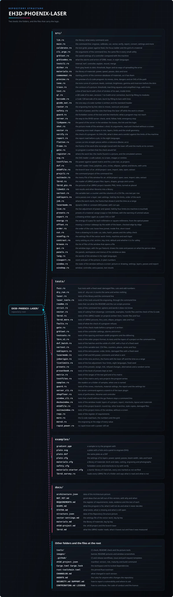

<p align="center">
  
</p>

#  EH3D-PHOENIX-LASER
<p align="center"><a href="README.md">🇺🇸 English</a> | <a href="README_spa.md">🇪🇸 Español</a> | <a href="README_fra.md">🇫🇷 Français</a> | <a href="README_ita.md">🇮🇹 Italiano</a> | <a href="README_deu.md">🇩🇪 Deutsch</a> | <a href="README_zho.md">🇨🇳 中文</a> | <a href="README_jpn.md">🇯🇵 日本語</a> | 🇵🇹 <b>Português</b></p>

### Gravação a laser a partir de uma imagem e corte a partir de um desenho: tramagem, G-code de trama, contornos SVG e DXF e grelha de calibração

<p align="center">
  
  
  
  
  
</p>

---

**Verificação de honestidade - o que funciona hoje:** uma biblioteca Rust e um programa de linha de comandos (`phoenix-laser`) com 509 testes que correm num computador: converte uma imagem em pontos por tramagem e escreve o G-code de um laser que queima linha a linha com potência dinâmica e sobrecurso, lê desenhos SVG e DXF e escreve o G-code que corta os seus contornos (os de dentro primeiro, com a largura do feixe, pontes e várias passagens) e grava as suas formas com linhas, com as definições de cada camada num ficheiro, e uma grelha de teste de potência contra avanço. Tem uma janela (compilada com `--features gui`) que abre uma imagem ou um desenho, mostra o percurso do laser, permite alterar as definições e exporta o G-code, mas a janela ainda não foi vista num ecrã; não foi experimentado numa máquina e não foi verificado com uma coleção de ficheiros reais.

---

> **Estado de segurança:** este programa não controla nenhuma máquina e não é um sistema de segurança. O que produz deve ser verificado por uma pessoa antes de se executar algo numa máquina; nada disto correu em hardware real.


## 📋 Num relance

| | |
|---|---|
| Versão | `0.0.9` |
| Maturidade | Funcional |
| Testes | 509 |
| Tecnologias | Rust |
| Em hardware real | Não experimentado: nada disto correu numa máquina |

**Ir para:** [Visão geral](#-visão-geral) · [Arquitetura](#-arquitetura) · [Início rápido](#-início-rápido) · [Testes](#-testes) · [Estrutura](#-estrutura-do-repositório) · [Relacionados](#-projetos-relacionados)

## 🚦 Estado do projeto

Cada linha é uma parte deste repositório e a luz diz até onde chega hoje. É escrita com o que o repositório consegue demonstrar (testes, compilações, execuções), não com o que está previsto.

🟢 Feito e verificado · 🟡 Funciona, com limites conhecidos · 🟠 Feito a meio ou ainda por verificar · 🔴 Por fazer ou a não funcionar

| Área | Estado | O que significa aqui |
|---|---|---|
| Núcleo | 🟡 | converte uma imagem em pontos por tramagem e escreve o G-code de um laser que queima linha a linha com potência dinâmica e sobrecurso, lê desenhos SVG e DXF e corta-os ou grava-os por camada (contornos ordenados, largura do feixe, pontes, passagens, hachura), e uma grelha de teste de potência contra avanço; testado num computador com entradas normais e danificadas, não com uma coleção de ficheiros reais. |
| Linha de comandos | 🟡 | `phoenix-laser` (`engrave`, `calibrate`, `info`, `cut`, `vector`, `layers`) executa as mesmas funções que a biblioteca e imprime o resultado; cada erro volta como mensagem e código de saída diferente de zero. |
| Testes | 🟡 | 509 testes passam (`cargo test`), com casos normais, casos-limite e entradas danificadas. |
| Segurança | 🟡 | Rust seguro e simples (`forbid(unsafe_code)`): nada entra em pânico com os ficheiros recebidos e um valor mau é um erro com o seu motivo; sem revisão independente. |
| Janela | 🟠 | Escrita (egui, `--features gui`): abrir ou largar uma imagem ou um desenho SVG ou DXF, ver o percurso do laser (o corte numa cor, a deslocação atenuada), editar a tabela de camadas, uma grelha de calibração, zoom e deslocamento, estimar o tempo, exportar; a sua lógica está testada, mas ainda não foi compilada nem vista num ecrã. |
| Hardware real | 🔴 | Não experimentado: nada disto foi executado numa máquina. |
| Documentação | 🟡 | README em oito idiomas, o registo de alterações e as duas imagens desenhadas a partir de `docs/`. |

## 🎯 Visão geral

* **A imagem** (`eh3d-image`): PNG (cinzento, cor, transparente, 8 ou 16 bits) e PGM (texto e binário) tornam-se níveis de cinzento, com as partes transparentes como branco e o tamanho limitado para que um ficheiro hostil não possa pedir gigabytes; `resize` faz a média dos píxeis para que um ponto seja tão grande como o feixe.
* **Os pontos** (`src/dither.rs`): um limiar, ou difusão de erro de Floyd-Steinberg ou Atkinson; os testes verificam que a escuridão de um cinzento se conserva (um cinzento médio queima cerca de metade dos pontos) e que o branco não queima nada e o preto queima tudo.
* **O laser** (`src/raster.rs`, `src/calibrate.rs`): uma linha depois da outra, da esquerda para a direita e depois da direita para a esquerda, `M4` com `S0` enquanto viaja e a potência escolhida onde queima, um sobrecurso fixo ou calculado a partir da aceleração (v ao quadrado sobre 2a) e uma grelha de quadrados com uma potência por coluna e um avanço por linha para achar o que convém a um material.
* **O cabeçalho e os números de todo o ficheiro de G-code** (`src/gcode_out.rs`): o ficheiro começa com linhas de comentário que dizem o gerador e a sua versão, as unidades (mm, G21), a imagem de que foi feito com o seu SHA-256 e as ferramentas (o laser e a sua potência); uma grelha de calibração diz que não tem origem. Um número escreve-se de uma só maneira (no máximo três casas decimais, sem `-0`) e um valor que não é finito é recusado em vez de ser escrito como `NaN` ou `inf`.
* **`--dry-run`:** `engrave` calcula o resultado e conta-o (pontos, linhas, passagens, comprimento queimado, tempo) sem escrever o ficheiro de saída, que então pode ser omitido.
* **Os desenhos** (`src/svg.rs`, `src/dxf.rs`, `src/flatten.rs`, `src/vector.rs`): um subconjunto seguro de SVG (trajetos com todos os seus comandos, formas, transformações, grupos, unidades e um `use` de um elemento do mesmo ficheiro) e as entidades de um DXF (linhas, polilinhas com arcos, arcos, círculos, splines, unidades) transformam-se em formas em milímetros; os scripts, as imagens, um `use` de outro ficheiro, as entidades declaradas e tudo o que é desconhecido são ignorados ou recusados, o tamanho, a profundidade e o número de elementos (conta o que um `use` traz) e de pontos são limitados pelas definições, um `use` que volta a si mesmo é um erro, e as curvas passam a troços retos dentro de uma tolerância.
* **Corte e gravação** (`src/order.rs`, `src/offset.rs`, `src/cut.rs`): as formas são agrupadas por camada (DXF) ou cor (SVG); cada grupo é cortado (linhas soltas unidas, os contornos que estão dentro de outro primeiro, a menor deslocação, a largura do feixe descontada do lado certo, pontes por cortar, várias passagens com o foco a avançar) ou gravado (formas fechadas preenchidas com linhas num ângulo, pela regra par-ímpar) com as suas próprias definições.
* **O ficheiro de definições** (`src/vconfig.rs`, `docs/vector-settings.md`): todo o valor que se afina (os limites dos leitores, a máquina, as definições de cada camada) está num ficheiro de texto simples verificado linha a linha; nada disso está no código.
* **O teste de foco** (`src/calibrate.rs`, `[focus]` no ficheiro de definições): `phoenix-laser focus` queima uma escada de linhas curtas, cada uma com a cabeça a outra altura, e a linha mais nítida mostra onde o feixe está focado; o passo de altura não tem valor por omissão (qual é baixo depende da máquina), a potência obedece ao limite de potência e a cabeça volta à primeira altura.
* **A grelha de teste de um material** (`src/calibrate.rs`, `[calibrate]` no ficheiro de definições): `phoenix-laser calibrate --material NOME --materials FICHEIRO` distribui as potências e as velocidades da grelha em redor do que diz o material da biblioteca, dentro dos limites e sem repetir valores, e `--labels` queima a potência de cada coluna e a velocidade de cada linha ao lado dos quadrados com um tipo de letra de traços, para que a grelha possa ser lida depois no material; um material acima de um limite é recusado, nunca baixado. Com um material os algarismos saem por omissão (`--no-labels` retira-os) e a potência e a velocidade mínimas da escada são as chaves `min_power_percent` e `min_feed_mm_min`.
* **A moldura do trabalho** (`src/frame.rs`, `[frame]` no ficheiro de definições): `phoenix-laser frame` escreve um programa que percorre o retângulo do trabalho com o laser desligado, a partir de um tamanho ou da caixa do que um programa G-code queima, para ver onde vai cair; uma potência piloto fraca exige `--confirm-laser-on` de cada vez, tem teto de 5 % (`max_pilot_percent` de `[frame]` muda o teto) e obedece ao limite de potência, e uma moldura fora da mesa é recusada.
* **A pré-visualização** (`src/preview.rs`): `phoenix-laser preview` lê um programa G-code (o próprio ou de outro), imprime os movimentos, o comprimento queimado e percorrido, a caixa, as potências e um tempo que conta a travagem nos cantos, avisa do que parece perigoso (laser ligado num movimento rápido, sem avanço, potência acima da plena, trabalho fora da mesa, sem fim) e desenha o percurso como SVG; os testes voltam a ler o que a gravação escreve e verificam o mesmo comprimento.
* **A biblioteca de materiais** (`src/materials.rs`, `examples/materials.cfg`): o que convém a cada material e modo de trabalho escreve-se uma vez num ficheiro de texto (`[material NOME]`: potência, velocidade, passagens, passo de foco, largura do feixe, tracejado, tamanho do ponto, pontilhado e curva de tons) e escolhe-se com `--material NOME --materials FICHEIRO`; as opções da linha de comandos mandam sobre ele e o limite de potência vale sobre os dois. `phoenix-laser materials FICHEIRO` lista a biblioteca.
* **O limite de potência** (`src/safety.rs`, `max_power_percent` em `[machine]`, `--max-power`): um programa cuja potência passa do limite é recusado com um erro que nomeia a camada ou a opção, nunca baixado sem aviso; o limite é 100 % até um ficheiro ou uma opção dizer menos.
* **Perfis de máquina** (`[profile NAME]` no ficheiro de definições, `--profile NAME`): quem tem duas máquinas, ou troca o módulo laser por outro, guarda um perfil para cada uma (o curso da mesa, o limite de potência, o limite de velocidade, o valor de potência máxima e os watts); o perfil escolhido é a máquina, e `--max-speed` acompanha `--max-power`: uma velocidade acima do limite é recusada, nunca baixada.
* **Contornos a partir de uma imagem** (`src/trace.rs`, `[trace]` no ficheiro de definições): `phoenix-laser trace` segue o contorno de um logótipo, de uma silhueta ou de um estêncil em vez de o queimar ponto a ponto; os níveis de cinzento separam-se com um limiar, o bordo é encontrado com marching squares de precisão subpixel, simplificado até nenhum ponto ficar a mais de `simplify_mm` da linha, e as manchas são descartadas; o resultado é uma camada de um desenho, cortada (ou preenchida com linhas) com as mesmas definições e as mesmas verificações, e o tamanho da imagem, os pedaços de bordo, os contornos e os pontos estão todos limitados.
* **Tons, materiais e limites na janela** (`src/window.rs`): as caixas da curva de tons (gama, contraste, brilho, inverter e níveis automáticos) trabalham a imagem com a mesma função da linha de comandos; uma biblioteca de materiais carrega-se a partir de um ficheiro (ou do que `PHOENIX_LASER_MATERIALS` indicar) e escolher um material preenche as caixas de potência, velocidade, ponto, pontilhado, tons e de cada camada de um desenho; os limites de potência e de velocidade também são caixas e um valor acima é recusado, nunca baixado. Os valores iniciais vêm do ficheiro de definições (`[tone]`, `[machine]`).
* **O teste de focagem na janela** (`src/window.rs`): um modo com as caixas da secção `[focus]` (a altura da primeira linha, o passo, o número e o comprimento das linhas, o espaçamento, a velocidade e a potência); o teste é calculado com a mesma função de `phoenix-laser focus`, a potência e a velocidade obedecem aos limites, não há passo por omissão porque o sentido para baixo depende da máquina, e um aviso de que o teste move o Z fica nas notas.
* **A moldura na janela** (`src/window.rs`, `[frame]` no ficheiro de definições): um modo que enquadra a imagem ou o desenho aberto com o laser desligado; a margem, as voltas e a velocidade são caixas. Uma potência piloto acima de 0 liga o laser, por isso a janela pergunta e nada é calculado nem escrito até a pessoa responder que sim, de cada vez (mudar uma caixa, mudar de modo ou escrever o ficheiro retira a resposta), sob o teto de `max_pilot_percent`, o limite de potência e a mesa.
* **A pré-visualização na janela** (`src/window.rs`): todo o G-code que a janela calcula é contado pela mesma pré-visualização de `phoenix-laser preview` (movimentos, comprimento queimado e percorrido, um tempo que conta as esquinas com a aceleração da caixa e o que parece perigoso, como o trabalho fora da mesa do ficheiro de definições), e um programa de qualquer origem (`.nc`, `.ngc`, `.gcode`, `.gc`, `.tap`) pode ser aberto ou largado na janela para ver o seu trajeto e as suas notas. É lido como texto, nunca executado e nunca escrito de novo.
* **O contorno na janela** (`src/window.rs`, `[trace]` no ficheiro de definições): um modo que segue o contorno da imagem aberta com a mesma função de `phoenix-laser trace` e o corta, ou preenche as suas formas com linhas, como uma camada chamada `trace`; as caixas são o limiar, a simplificação e a peça mínima, com um interruptor para uma tinta clara; a potência e a velocidade são as das caixas do laser e obedecem aos limites, e os limites da imagem (`max_pixels`, `max_contours`, `max_segments`) são os do ficheiro de definições, de modo que uma imagem demasiado detalhada é um erro e não um programa lento.
* **O perfil de máquina na janela** (`src/window.rs`, `[profile NAME]` no ficheiro de definições): uma lista no painel lateral com as máquinas do ficheiro; a escolhida é a máquina, tal como `--profile` a faz, de modo que as caixas do valor de potência total e dos limites de potência e de velocidade tomam os seus valores e a mesa do perfil é a que a moldura e a pré-visualização verificam. O que um perfil omite vem de `[machine]`, um perfil que não está no ficheiro não altera nada, e os limites continuam a recusar uma potência ou uma velocidade acima deles.
* **A verificação de um programa** (`src/verify.rs`): `phoenix-laser verify PROGRAMA.nc` lê um programa G-code (deste programa ou de outro) como texto, nunca o executa, e dá o SHA-256 do ficheiro exato, o que faz e um veredicto: só passa abaixo do limite de potência e de velocidade da máquina, dentro da mesa (o trabalho fora dela falha; `--overscan-mm` ou `overscan_mm` em `[verify]` deixa a cabeça passar da mesa essa distância com o laser desligado, como o excesso de varrimento de outro programa, e queimar fora da mesa falha sempre), com o laser desligado em cada movimento rápido e avanço em cada movimento que queima. `--json` dá o relatório para outro programa guardar junto de uma autorização ligada a esse hash, com o perfil de máquina, o SHA-256 do ficheiro de definições de onde vêm os limites e os nomes das verificações feitas, e o código de saída é 1 quando falha.
* **Pontilhado ordenado** (`src/dither.rs`): `--dither bayer` (também na janela) decide cada ponto pelo seu lugar e pelo seu cinzento com uma matriz de Bayer de 8 x 8, por isso o padrão é regular e o mesmo cinzento queima sempre os mesmos pontos; os testes verificam que cada nível da matriz aparece uma vez e que a escuridão de um cinzento se mantém.
* **A curva de tons** (`src/tone.rs`): antes de fazer os pontos, os cinzentos podem ser esticados a toda a gama (`--auto-level`), receber mais ou menos contraste e brilho, ser curvados com um gama ou invertidos, com uma única tabela de 256 entradas; com os valores por omissão a imagem não muda de todo.
* **Um G-code verificado:** o programa de um desenho é verificado linha a linha antes de ser entregue: nenhum laser ligado durante um movimento rápido ou sem velocidade, nenhum `S` acima da potência máxima, nenhum movimento fora da mesa, `M5` no fim; o ficheiro nunca é escrito por cima do desenho nem das definições de que provém.

## 🧩 Papel no EH3D

EH3D-PHOENIX-LASER é um programa da EH3D Fabrication Suite. Funciona como biblioteca e linha de comandos e, compilado com `--features gui`, como janela com o aspeto que os outros programas da suíte partilham. Lê e escreve ficheiros simples, por isso pode ser usado sozinho ou entre os outros programas.

## 🏛️ Arquitetura

<p align="center">
  
</p>


Como as partes deste repositório se encaixam: quem o usa, o que contém e de que depende. A imagem é desenhada a partir de `docs/architecture.json` e verificada com o código.

## ✨ Funcionalidades

* **Biblioteca e linha de comandos:** cada comando de `phoenix-laser` é uma função da biblioteca, por isso outro programa da suíte pode chamá-la sem lançar um processo.
* **Linha de comandos estrita:** uma opção mal escrita (`--powr`) ou uma palavra a mais é um erro que a nomeia, não algo que se ignora; caso contrário o programa faria a sua saída com os valores por omissão.
* **Testes com entradas danificadas:** os testes também dão ficheiros vazios, lixo, números enormes e ficheiros cortados, e nenhum pode entrar em pânico.
* **Sem adivinhar:** um valor sem sentido é um erro que diz qual e porquê, nunca um resultado que apenas parece certo.
* **Sem código unsafe:** `#![forbid(unsafe_code)]` na biblioteca e no programa.

## 🔒 Segurança e proteção

| Ameaça | Defesa |
|---|---|
| Um ficheiro danificado, cortado ou vazio | sem pânico: os testes cortam uma entrada válida em cada posição e dão lixo |
| Um número sem sentido (negativo, não finito, absurdamente grande) | recusado com um erro que nomeia o valor; nada é arredondado para algo plausível |
| Uso inseguro de memória | Rust seguro e simples com `forbid(unsafe_code)` |
| Um desenho hostil (scripts, entidades declaradas, aninhamento profundo, milhões de pontos, números enormes) | os scripts, as imagens e as ligações nunca são executados nem descarregados; uma entidade declarada é um erro; o tamanho, a profundidade, os elementos, as formas, os pontos e os troços de uma curva são limitados; uma forma com um ponto fora do intervalo fica de fora |
| Um programa que poderia ligar o laser sem velocidade ou acima da potência máxima | cada programa é verificado linha a linha antes de ser entregue e o que falha não é escrito |
| Uma potência superior à que a máquina ou o material devem receber | o limite de potência (`max_power_percent`, `--max-power`) recusa um programa que o ultrapasse com um erro que nomeia a camada ou a opção; nunca é baixada sem aviso |
| Uma biblioteca de materiais estragada ou enorme | o ficheiro tem limite de tamanho e de número de materiais; um valor fora do intervalo, uma chave desconhecida ou um nome repetido é um erro que nomeia a linha; a saída nunca é escrita por cima dela |
| Um programa G-code de fora que se lê antes de o executar | a pré-visualização só lê texto, com limite de tamanho, nunca executa nem descarrega nada, ignora números absurdos e avisa de laser ligado num movimento rápido, sem avanço, potência acima da plena, trabalho fora da mesa e sem fim |
| O laser a ligar só para posicionar o trabalho | a moldura é percorrida com o laser desligado (sem potência, o fuso nunca ligado); uma potência piloto exige `--confirm-laser-on` em cada execução, mesmo que o ficheiro de definições a peça, fica no teto ou abaixo (5 % se `max_pilot_percent` não indicar outro), sob o limite de potência e é desligada antes de o programa acabar |
| Uma cabeça enviada no sentido errado em Z por um teste de foco | o passo de altura não tem valor por omissão e o teste é recusado até a pessoa o dar; o programa avisa de que move Z, o curso é limitado (50 mm no total), a cabeça volta à primeira altura e a potência obedece ao limite de potência |
| O ficheiro de saída escolhido por cima do desenho ou das definições de que provém | recusado, na janela e nos comandos |

**O que não é defendido:** um resultado produzido sem erros não é um resultado verificado. Nada aqui conhece os limites de uma máquina e o programa não teve revisão independente. Comunique uma vulnerabilidade em privado (ver [SECURITY.md](SECURITY.md)).

## 🔌 Interfaces

A biblioteca é `eh3d_phoenix_laser` (`use eh3d_phoenix_laser::...`); a linha de comandos é `phoenix-laser`. Os comandos são estes; cada um imprime o resultado na saída padrão e comunica um erro na saída de erros com um código de saída diferente de zero. Não há acesso à rede.

```text
phoenix-laser engrave IMAGE OUT.nc --width-mm 50 [--dot-mm 0.1] [--feed 3000] [--power 50] [--smax 1000]
              [--dither fs|atkinson|threshold|bayer] [--threshold 128] [--overscan MM|auto] [--accel 1000] [--origin X,Y] [--dry-run]
              [--gamma 1] [--contrast 0] [--brightness 0] [--invert] [--auto-level] [--max-power 100] [--max-speed MM/MIN] [--config FILE] [--profile NAME]
              [--material NAME --materials FILE]
phoenix-laser calibrate OUT.nc --powers 20,40,60,80 --feeds 1000,2000,3000 [--smax 1000] [--max-power 100] [--max-speed MM/MIN] [--config FILE] [--profile NAME]
phoenix-laser calibrate OUT.nc --material NAME --materials FILE [--steps 5] [--spread 40] [--labels|--no-labels] [--label-mm 3] [--smax 1000] [--max-power 100] [--max-speed MM/MIN] [--config FILE] [--profile NAME]
phoenix-laser info IMAGE
phoenix-laser cut DRAWING OUT.nc [--config FILE] [--power P] [--speed MM/MIN] [--passes N] [--focus-step MM] [--kerf MM] [--kerf-side none|auto|inside|outside]
              [--tabs N] [--tab-width MM] [--smax N] [--overscan MM] [--origin X,Y] [--bed X,Y] [--max-power P] [--max-speed MM/MIN] [--profile NAME] [--material NAME --materials FILE] [--dpi N] [--tolerance MM] [--dry-run]
phoenix-laser vector DRAWING OUT.nc [the options of cut] [--angle DEG] [--spacing MM]
phoenix-laser layers DRAWING [--config FILE] [--dpi N]
phoenix-laser trace IMAGE OUT.nc --width-mm W [--threshold 128] [--invert] [--simplify MM] [--min-area MM2] [--engrave] [the options of cut]
phoenix-laser materials FILE
phoenix-laser focus OUT.nc --z-step MM [--z-start MM] [--steps 9] [--length 10] [--spacing 2] [--feed 1000] [--power 30] [--smax 1000] [--max-power P] [--max-speed MM/MIN] [--config FILE] [--profile NAME]
phoenix-laser frame OUT.nc --size W,H | --gcode PROGRAM.nc [--origin X,Y] [--margin MM] [--feed 3000] [--laps 1] [--bed X,Y] [--smax N]
              [--pilot P --confirm-laser-on] [--max-power P] [--max-speed MM/MIN] [--config FILE] [--profile NAME]
phoenix-laser verify PROGRAM.nc [--config FILE] [--profile NAME] [--smax N] [--max-power P] [--max-speed MM/MIN] [--bed X,Y] [--overscan-mm MM] [--accel 1000] [--json]
phoenix-laser preview PROGRAM.nc [OUT.svg] [--accel 1000] [--rapid 6000] [--smax N] [--bed X,Y] [--width-px 900] [--config FILE] [--profile NAME]
phoenix-laser [gui] [FILE]                       the window (a build with --features gui); with no arguments it opens
```

`DRAWING` é um ficheiro SVG ou DXF. `cut` segue os contornos (os de dentro primeiro); `vector` preenche as formas fechadas com linhas e segue as abertas; ambos tomam as definições de cada camada ou cor de `--config FILE` (ver [docs/vector-settings.md](docs/vector-settings.md)) e uma opção da linha de comandos altera-as em todas as camadas. `layers` lista as camadas de um desenho com o que se faria com cada uma.

## ⚙️ Configuração

A gravação de uma imagem define-se com argumentos da linha de comandos (ver Interfaces) e cada valor por omissão está escrito na ajuda do comando (`phoenix-laser help`). O corte e a gravação de um desenho definem-se com um ficheiro de definições (`--config FILE`, ou «Carregar definições» na janela): os limites dos leitores, como se lê um ficheiro, a ordem dos cortes, a máquina e, para cada camada ou cor, o modo (cortar, gravar ou ignorar), a potência, a velocidade, as passagens, o avanço do foco, a largura do feixe e o seu lado, as pontes e a hachura. Cada chave, o seu valor por omissão e o seu intervalo estão em [docs/vector-settings.md](docs/vector-settings.md) e há um exemplo em `examples/plate.cfg`; uma chave desconhecida ou um valor fora do intervalo é um erro que nomeia a sua linha. Os limites fixos do leitor de imagens estão no código como constantes com nome e são cobertos por testes.

## 🚀 Início rápido

Precisa de uma cadeia de ferramentas Rust estável (1.88 ou mais recente). O repositório EH3D-COMMON tem de estar clonado ao lado deste: o leitor de imagens é tomado dele por caminho.

```bash
cargo build --release
cargo test
cargo run --release -- engrave examples/gradient.pgm examples/gradient.nc --width-mm 16 --dot-mm 0.5 --overscan auto
cargo run --release -- cut examples/plate.svg examples/plate.nc --config examples/plate.cfg
cargo run --release --features gui   # the window
cargo run --release --features gui -- --shot screen.png examples/plate.svg   # a picture of the window
```

Para tirar uma captura da janela sem a abrir à mão, execute-o com `--shot FICHEIRO.png` (também `--size WxH`, `--theme forge|dark|light`, `--wait N`, `--lang CODE`, `--open FILE`, `--replace`): abre-se com esse tamanho, guarda o PNG, não guarda definições e fecha-se sozinho (código de saída 0 se o ficheiro foi escrito, 1 se não, 2 se os argumentos estiverem errados).

## 🧪 Testes

O conjunto tem 509 testes (`cargo test`, executados em Windows e Linux no CI). Verificam os casos normais, os casos-limite e as entradas danificadas: ficheiros vazios, lixo e ficheiros cortados nunca provocam pânico. O CI executa ainda `cargo fmt --check`, `cargo clippy` com avisos como erros e `python -I tools/ci_validate.py`.

## 🏗️ Compilação e publicação

A versão está em `Cargo.toml` e em `eh3d.project.json`; cada versão tem a sua entrada em [CHANGELOG.md](CHANGELOG.md). `build.bat` / `build.sh` compilam o programa, `test.bat` / `test.sh` executam os testes e `run.bat` / `run.sh` executam-no com um exemplo. As versões são publicadas no GitHub.

**Transferências:** Com cada versão deste repositório são publicados programas já feitos para cada sistema: Windows (64 e 32 bits), Linux (64 bits) e macOS (Apple silicon e Intel). Cada pacote, `phoenix-laser-<versão>-<sistema>.zip` ou `.tar.gz`, leva o programa, a licença, este README, o registo de alterações, o ícone e os ficheiros de exemplo, e vem com o seu ficheiro `.sha256`; a versão também lista todos os ficheiros em `SHA256SUMS` e `build-manifest.json`. Ainda não foi publicada nenhuma versão.

**Assinados e verificáveis:** os pacotes de uma versão são assinados com a chave de versões da EH3D, e o ficheiro `.sig` de cada pacote é publicado ao lado (uma assinatura OpenSSH, espaço de nomes `eh3d-release`). Verifique uma transferência antes de a executar: compare o seu SHA-256 (`sha256sum -c phoenix-laser-<versão>-<sistema>.tar.gz.sha256`, ou `Get-FileHash` no Windows) e verifique a assinatura com `ssh-keygen -Y verify -f allowed_signers -I eh3d-release -n eh3d-release -s <pacote>.sig < <pacote>`, onde `allowed_signers` contém a linha `eh3d-release <tipo de chave> <chave pública das versões da EH3D>`.

## 📂 Estrutura do repositório

<p align="center">
  
</p>

<details>
<summary>Versão em texto da árvore</summary>

```text
EH3D-PHOENIX-LASER/
├── src/
│   ├── lib.rs                                   a biblioteca: o que cada comando usa
│   ├── main.rs                                  a linha de comandos: engrave, calibrate, info, cut, vector, trace, verify e layers
│   ├── calibrate.rs                             uma parte da lógica
│   ├── cli_args.rs                              os argumentos da linha de comandos, o mesmo ficheiro em cada utilitário pequeno
│   ├── dither.rs                                uma parte da lógica
│   ├── materials.rs                             a biblioteca de materiais: potência, velocidade, passagens, tons
│   ├── preview.rs                               a pré-visualização de um G-code: movimentos, tempo, perigos e um SVG do percurso
│   ├── tone.rs                                  a curva de tons de uma imagem: níveis, contraste, brilho, gama e inversão antes dos pontos
│   ├── trace.rs                                 os contornos de uma imagem: limiar, marching squares e anéis simplificados, com limites
│   ├── gcode_out.rs                             a única forma de escrever um número de G-code e o cabeçalho padrão
│   ├── raster.rs                                uma parte da lógica
│   ├── safety.rs                                o limite de potência e as regras que mantêm o laser desligado ao mostrar o trabalho
│   ├── shot.rs                                  o modo de captura da janela (--shot): os seus argumentos, lidos e verificados sem ecrã
│   ├── vector.rs                                um desenho lido: formas em mm, camadas, limites e a geometria básica
│   ├── verify.rs                                a verificação de um programa: o seu SHA-256, o que faz e um veredicto face aos limites da máquina
│   ├── flatten.rs                               curvas em troços retos dentro de uma tolerância (Bézier, arcos)
│   ├── frame.rs                                 a moldura do trabalho: o retângulo percorrido com o laser desligado
│   ├── svg.rs                                   o leitor de SVG: um subconjunto seguro, sem scripts, imagens nem entidades
│   ├── dxf.rs                                   o leitor de DXF: linhas, polilinhas, arcos, círculos e splines, com unidades
│   ├── energy.rs                                a energia de uma passagem por milímetro ou milímetro quadrado, a partir da potência ótica
│   ├── offset.rs                                deslocar um contorno de lado pela largura do feixe, verificado aresta a aresta
│   ├── order.rs                                 a ordem dos cortes: linhas unidas, o interior primeiro, pouco deslocamento
│   ├── cut.rs                                   do desenho ao G-code: corte, pontes, hachura, passagens e a verificação de segurança
│   ├── vconfig.rs                               o ficheiro de definições do trabalho vetorial: limites, máquina e cada camada
│   ├── browse.rs                                a lista de ficheiros da janela que abre um ficheiro
│   ├── gui.rs                                   a janela (egui, com a funcionalidade gui): desenha o estado e transmite o que a pessoa faz
│   ├── lang.rs                                  as palavras da janela nos oito idiomas
│   ├── viewport.rs                              zoom e deslocamento da imagem, em números simples
│   └── window.rs                                o estado da janela sem ecrã: imagem ou desenho, definições, camadas, passagens e exportação
├── tests/
│   ├── fuzz.rs                                  testes com semente fixa: ficheiros danificados, cortes e números estranhos
│   ├── dry_run.rs                               testes de --dry-run: conta o mesmo e não escreve nada
│   ├── laser.rs                                 testes da biblioteca e da linha de comandos
│   ├── laser_tools.rs                           testes das ferramentas à volta da gravação, pela linha de comandos
│   ├── readme.rs                                testes que executam o que o README e os scripts run prometem
│   ├── strict.rs                                testes da linha de comandos: opções e palavras que não conhece
│   ├── vector.rs                                testes do corte a partir de desenhos: comandos, exemplos, ficheiros hostis e a verificação do G-code
│   └── window_cli.rs                            testes de que uma compilação sem a funcionalidade gui continua a ser só linha de comandos
├── examples/
│   ├── gradient.pgm                             um exemplo para experimentar o programa
│   ├── plate.svg                                uma placa com um furo e um painel para gravar (SVG)
│   ├── plate.dxf                                a mesma placa em DXF
│   ├── plate.cfg                                as definições das suas camadas: potência, velocidade, passagens, largura do feixe, pontes e hachura
│   └── materials.cfg                            uma biblioteca de materiais: vidoeiro e ardósia, corte, gravação e fotografias
├── docs/
│   ├── architecture.json                        dados da imagem de Arquitetura
│   ├── structure.json                           dados da imagem de Estrutura
│   ├── vector-settings.md                       o ficheiro de definições do trabalho vetorial, chave a chave
│   └── materials.md                             a biblioteca de materiais, chave a chave
├── tools/                                       verificação da CI e do README e ferramentas de imagens
├── images/                                      banner e as imagens de Arquitetura e Estrutura do repositório
├── .github/                                     fluxos de CI e de publicação, modelos de issues e pull requests
├── eh3d.project.json                            manifesto: versão, papel, maturidade e comando de compilação
├── Cargo.toml Cargo.lock                        o workspace e as suas dependências fixadas
├── rust-toolchain.toml                          a toolchain de Rust fixada
├── CHANGELOG.md                                 o que mudou em cada versão
├── SECURITY.md SUPPORT.md                       como comunicar uma vulnerabilidade e onde perguntar
└── CONTRIBUTING.md CODE_OF_CONDUCT.md LICENSE   como contribuir, o código de conduta e a licença
```

</details>

## 🗺️ Roteiro e limites conhecidos

**Limites conhecidos hoje**

* A janela ainda não foi vista num ecrã.
* Não foi experimentado numa máquina nem com uma coleção de ficheiros reais e não teve revisão independente.
* Um desenho é lido num subconjunto seguro (sem `use` de outro ficheiro, texto, gradientes nem estilos com seletores; sem elipses, hachuras nem blocos num DXF); um contorno mais estreito do que o feixe não é cortado e o programa di-lo; o laser é o de um controlador GRBL com `M4` e nada foi experimentado num laser nem num material reais.

**A seguir**

* Mostrar a densidade de potência na placa antes de queimar (`layers` já escreve a energia de uma passagem quando `laser_watts` está definido) e manter constante a potência nos cantos de um corte.
* Ver a janela num ecrã e terminá-la.
* Experimentá-lo com desenhos reais e com os outros programas da suite.

## 🌍 Idiomas

O README e os textos existem em inglês, espanhol, francês, italiano, alemão, chinês, japonês e português europeu.

## 🔗 Projetos relacionados

* [EH3D-COMMON](https://github.com/JuanenRac/EH3D-COMMON): os crates partilhados, entre eles o leitor de imagens
* [EH3D-STENCILCAM](https://github.com/JuanenRac/EH3D-STENCILCAM): os stencils de pasta de solda
* [EH3D-CAM-DEBUGGER](https://github.com/JuanenRac/EH3D-CAM-DEBUGGER): a verificação do G-code antes de chegar a uma máquina
* [EH3D-TOOL-MANAGER](https://github.com/JuanenRac/EH3D-TOOL-MANAGER): o armazém de ferramentas partilhado pelos programas CAM
* [EH3D-MOTIONCNC](https://github.com/JuanenRac/EH3D-MOTIONCNC): o programa de controlo de máquina
* [EH3D-SUITE-LAUNCHER](https://github.com/JuanenRac/EH3D-SUITE-LAUNCHER): o centro que encontra e arranca os programas da suíte

## 📚 Documentação

* [Registo de alterações](CHANGELOG.md)
* [Dados de arquitetura e estrutura](docs/architecture.json): os dados a partir dos quais as duas imagens são desenhadas.
* [Definições do trabalho vetorial](docs/vector-settings.md): cada chave do ficheiro de definições com o seu valor por omissão e o seu intervalo.
* [A biblioteca de materiais](docs/materials.md): cada chave de um material e como um material é aplicado

## 🤝 Contribuir e comunidade

* Antes de um pull request execute `cargo fmt --check`, `cargo clippy --all-targets -- -D warnings`, `cargo test` e `python -I tools/ci_validate.py`: tudo tem de passar. Veja [CONTRIBUTING.md](CONTRIBUTING.md) e o [código de conduta](CODE_OF_CONDUCT.md).
* O README existe em oito idiomas: uma alteração ao texto faz-se nos oito ficheiros, e as duas imagens são desenhadas a partir de `docs/architecture.json` e `docs/structure.json` por `tools/make_architecture.py` e `tools/make_structure.py`.
* Comunique uma vulnerabilidade em privado: [SECURITY.md](SECURITY.md). Perguntas, ideias e relatos: electrohobby3d@gmail.com ([SUPPORT.md](SUPPORT.md)).

## 👤 AUTOR

**JuanenRac (Electro Hobby 3D)** · electrohobby3d@gmail.com

## 📜 LICENÇA

Software: GPL-3.0-or-later. Ver [LICENSE](LICENSE). Os projetos de hardware da suite usam a CERN OHL-S.
