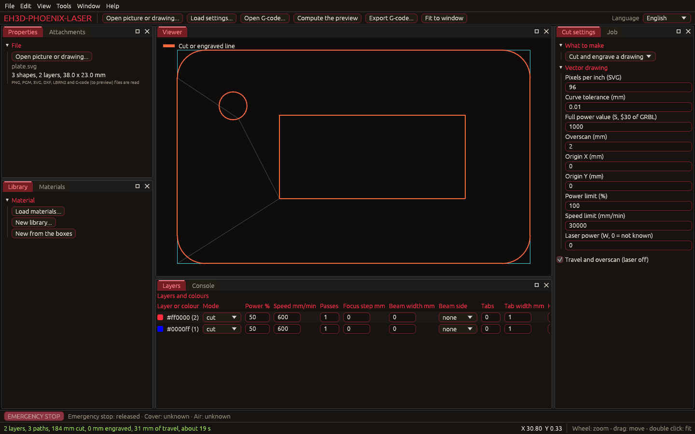
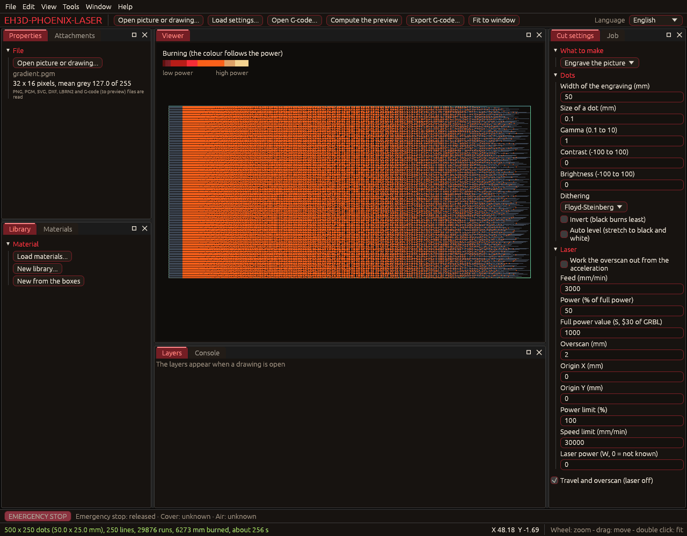

<p align="center">
  
</p>

#  EH3D-PHOENIX-LASER
<p align="center"><a href="README.md">🇺🇸 English</a> | 🇪🇸 <b>Español</b> | <a href="README_fra.md">🇫🇷 Français</a> | <a href="README_ita.md">🇮🇹 Italiano</a> | <a href="README_deu.md">🇩🇪 Deutsch</a> | <a href="README_zho.md">🇨🇳 中文</a> | <a href="README_jpn.md">🇯🇵 日本語</a> | <a href="README_por.md">🇵🇹 Português</a></p>

### Grabado láser desde una imagen y corte desde un dibujo: tramado, G-code de trama, contornos SVG y DXF y rejilla de calibración

<p align="center">
  
  
  
  
  
</p>

---

**Comprobación de honestidad - lo que funciona hoy:** una biblioteca Rust y un programa de línea de comandos (`phoenix-laser`) con 612 pruebas que se ejecutan en un ordenador: convierte una imagen en puntos por tramado y escribe el G-code de un láser que quema línea a línea con potencia dinámica y sobrerrecorrido, lee dibujos SVG y DXF y escribe el G-code que corta sus contornos (los de dentro primero, con el ancho del haz, puentes y varias pasadas) y graba sus formas con líneas, con los ajustes de cada capa en un fichero, y una rejilla de prueba de potencia contra avance. Tiene una ventana (se compila con `--features gui`) que abre una imagen o un dibujo, muestra el recorrido del láser, permite cambiar los ajustes y exporta el G-code, pero todavía no se ha visto en una pantalla; no se ha probado en una máquina y no se ha comprobado con una colección de ficheros reales.

---

> **Estado de seguridad:** este programa no controla ninguna máquina y no es un sistema de seguridad. Lo que produce debe revisarlo una persona antes de ejecutar nada en una máquina; nada de esto se ha ejecutado en hardware real.


## 📋 De un vistazo

| | |
|---|---|
| Versión | `0.1.2` |
| Madurez | Funcional |
| Pruebas | 612 |
| Pila tecnológica | Rust |
| En hardware real | No probado: nada de esto se ha ejecutado en una máquina |

**Ir a:** [Resumen](#-resumen) · [Arquitectura](#-arquitectura) · [Inicio rápido](#-inicio-rápido) · [Pruebas](#-pruebas) · [Estructura](#-estructura-del-repositorio) · [Relacionados](#-proyectos-relacionados)

## 🚦 Estado del proyecto

Cada línea es una parte de este repositorio y la luz dice hasta dónde llega hoy. Se escribe con lo que el repositorio puede demostrar (pruebas, compilaciones, ejecuciones), no con lo previsto.

🟢 Hecho y verificado · 🟡 Funciona, con límites conocidos · 🟠 Hecho a medias o sin verificar · 🔴 Sin hacer o sin funcionar

| Área | Estado | Qué significa aquí |
|---|---|---|
| Núcleo | 🟡 | convierte una imagen en puntos por tramado y escribe el G-code de un láser que quema línea a línea con potencia dinámica y sobrerrecorrido, lee dibujos SVG y DXF y los corta o graba por capas (contornos ordenados, ancho del haz, puentes, pasadas, rayado) y una rejilla de prueba de potencia contra avance; probado en un ordenador con entradas normales y dañadas, no con una colección de ficheros reales. |
| Línea de comandos | 🟡 | `phoenix-laser` (`engrave`, `calibrate`, `info`, `cut`, `vector`, `layers`) ejecuta las mismas funciones que la biblioteca e imprime el resultado; cada error vuelve como mensaje y un código de salida distinto de cero. |
| Pruebas | 🟡 | 612 pruebas pasan (`cargo test`), con casos normales, casos límite y entradas dañadas. |
| Seguridad | 🟡 | Rust seguro y simple (`forbid(unsafe_code)`): nada entra en pánico con los ficheros recibidos y un valor malo es un error con su motivo; sin revisión independiente. |
| Ventana | 🟠 | Escrita (egui, `--features gui`): abrir o soltar una imagen o un dibujo SVG o DXF, ver el recorrido del láser (el corte en un color, el desplazamiento atenuado), editar la tabla de capas, una rejilla de calibración, zoom y desplazamiento, estimar el tiempo, exportar; su lógica está probada, pero todavía no se ha compilado ni visto en una pantalla. |
| Hardware real | 🔴 | No probado: nada de esto se ha ejecutado en una máquina. |
| Documentación | 🟡 | README en ocho idiomas, el registro de cambios y las dos imágenes dibujadas desde `docs/`. |

## 🎯 Resumen

* **La imagen** (`eh3d-image`): PNG (gris, color, transparente, 8 o 16 bits) y PGM (texto y binario) se convierten en niveles de gris, con las partes transparentes como blanco y el tamaño limitado para que un fichero hostil no pida gigabytes; `resize` promedia los píxeles para que un punto sea tan grande como el haz.
* **Los puntos** (`src/dither.rs`): umbral, o difusión de error de Floyd-Steinberg o Atkinson; las pruebas comprueban que se conserva la oscuridad de un gris (un gris medio quema la mitad de los puntos) y que el blanco no quema nada y el negro lo quema todo.
* **El láser** (`src/raster.rs`, `src/calibrate.rs`): una línea tras otra, de izquierda a derecha y luego de derecha a izquierda, `M4` con `S0` mientras viaja y la potencia elegida donde quema, un sobrerrecorrido fijo o calculado con la aceleración (v al cuadrado entre 2a) y una rejilla de cuadrados con una potencia por columna y un avance por fila para hallar lo que conviene a un material.
* **La cabecera y los números de todo fichero de G-code** (`src/gcode_out.rs`): el fichero empieza con líneas de comentario que dicen el generador y su versión, las unidades (mm, G21), la imagen de la que se hizo con su SHA-256 y las herramientas (el láser y su potencia); una rejilla de calibración dice que no tiene origen. Un número se escribe de una sola manera (como mucho tres decimales, sin `-0`) y un valor que no es finito se rechaza en vez de escribirse como `NaN` o `inf`.
* **`--dry-run`:** `engrave` calcula el resultado y lo cuenta (puntos, líneas, tramos, longitud quemada, tiempo) sin escribir el fichero de salida, que entonces puede omitirse.
* **Los dibujos** (`src/svg.rs`, `src/dxf.rs`, `src/flatten.rs`, `src/vector.rs`): un subconjunto seguro de SVG (trazados con todas sus órdenes, formas, transformaciones, grupos, unidades y un `use` de un elemento del mismo fichero) y las entidades de un DXF (líneas, polilíneas con arcos, arcos, círculos, splines, unidades) se convierten en formas en milímetros; los scripts, las imágenes, un `use` de otro fichero, las entidades declaradas y todo lo desconocido se omiten o se rechazan, el tamaño, la profundidad y el número de elementos (cuenta lo que trae un `use`) y de puntos están limitados por los ajustes, un `use` que vuelve a sí mismo es un error, y las curvas se convierten en tramos rectos dentro de una tolerancia.
* **Corte y grabado** (`src/order.rs`, `src/offset.rs`, `src/cut.rs`): las formas se agrupan por capa (DXF) o color (SVG); cada grupo se corta (líneas sueltas unidas, los contornos que están dentro de otro primero, el menor desplazamiento, el ancho del haz descontado del lado correcto, puentes sin cortar, varias pasadas con el foco avanzando) o se graba (formas cerradas rellenas de líneas con un ángulo, por la regla par-impar) con sus propios ajustes.
* **El fichero de ajustes** (`src/vconfig.rs`, `docs/vector-settings.md`): todo valor que se afina (los límites de los lectores, la máquina, los ajustes de cada capa) está en un fichero de texto simple que se comprueba línea a línea; nada de eso está en el código.
* **La prueba de enfoque** (`src/calibrate.rs`, `[focus]` en el fichero de ajustes): `phoenix-laser focus` quema una escalera de líneas cortas, cada una con el cabezal a otra altura, y la línea más nítida muestra dónde está enfocado el haz; el paso de altura no tiene valor por defecto (qué es abajo depende de la máquina), la potencia obedece el límite de potencia y el cabezal vuelve a su primera altura. Con `--powers 10,20,30` (hasta 10 potencias) graba en cambio una rejilla de enfoque: las mismas líneas una vez por cada potencia, una columna al lado de otra, para leer qué potencia graba la línea más fina a la altura del enfoque; el cabezal va una sola vez a cada altura y graba todas las columnas de esa fila, y cada potencia obedece el límite de potencia.
* **La rejilla de prueba de un material** (`src/calibrate.rs`, `[calibrate]` en el fichero de ajustes): `phoenix-laser calibrate --material NOMBRE --materials FICHERO` reparte las potencias y las velocidades de la rejilla alrededor de lo que dice el material de la biblioteca, dentro de los límites y sin repetir valores, y `--labels` quema la potencia de cada columna y la velocidad de cada fila junto a los cuadrados con una letra de trazos, de modo que la rejilla se pueda leer después sobre el material; un material por encima de un límite se rechaza, nunca se baja. Con un material las cifras salen por defecto (`--no-labels` las quita) y la potencia y la velocidad mínimas de la escalera son las claves `min_power_percent` y `min_feed_mm_min`.
* **Texto** (`src/text.rs`, `[text]` en el fichero de ajustes): `phoenix-laser text OUT.nc --text TEXTO` quema un nombre, un número de serie o una marca con una fuente de trazos del programa (mayúsculas, cifras, espacio y `. , - + / : ! ? ( ) = _ '`; la minúscula se quema como mayúscula, un salto de línea empieza una fila) y sin fichero de fuente. La altura de una mayúscula, los huecos entre letras y filas, la potencia, la velocidad y las pasadas son ajustes; un carácter que la fuente no tiene, un texto de más de `max_chars` caracteres, una altura por encima de `max_height_mm`, una potencia o una velocidad por encima del límite, o un trabajo que saldría de la cama se rechazan, nunca se recortan, y el texto no se escribe nunca en un comentario del programa. Las filas de un texto de varias líneas pueden alinearse a la izquierda, al centro o a la derecha (`--align`), el texto puede grabarse como imagen en espejo para el reverso de vidrio o acrílico (`--mirror`) y se rechaza un grabado que tardaría más de `max_minutes`.
* **Código QR** (`src/qr.rs`, `[qr]` en el archivo de ajustes): `phoenix-laser qr OUT.nc --text DATOS` graba unos datos como un código QR propio del programa (versiones 1 a 4, de 21 a 33 módulos por lado, en modo byte, con los cuatro niveles de corrección de errores de Reed-Solomon y la máscara de menor penalización), rellenando cada módulo oscuro con líneas; el símbolo se ha leído de vuelta con un decodificador independiente en todas sus versiones y niveles, y las pruebas lo leen de vuelta con su propio lector. El lado del módulo, la distancia entre líneas, el nivel, la potencia, la velocidad, las pasadas y los límites son ajustes; unos datos por encima de `max_bytes`, una versión por encima de `max_version`, un símbolo mayor que `max_size_mm`, un relleno de más de `max_lines` movimientos, una potencia o una velocidad por encima del límite o un trabajo fuera de la cama se rechazan, nunca se recortan ni se reducen, y los datos nunca se escriben en un comentario del programa. `--print` muestra el símbolo como texto. Desactivado por defecto: `--invert` graba los módulos claros (con `--border-modules`, un borde grabado alrededor), `--mirror` graba la imagen en espejo para el reverso de vidrio o acrílico, `--overscan-mm` lleva el cabezal hasta cada línea y más allá con el láser apagado (se rechaza si saldría de la cama) y se rechaza un grabado que tardaría más de `max_minutes`.
* **Código de barras** (`src/barcode.rs`, `[barcode]` en el archivo de ajustes): `phoenix-laser barcode OUT.nc --text DATOS` graba unos datos como un código de barras Code 128 propio del programa (los caracteres del espacio a `~` en el juego B, y un texto de una cantidad par de cifras en el juego C, de la mitad de ancho, con su símbolo de control), rellenando cada barra con líneas a lo largo de su altura; las pruebas lo leen de vuelta con su propio lector, pero no se ha leído con un escáner. El ancho de la barra más estrecha, la altura, la distancia entre las líneas, la potencia, la velocidad, las pasadas y los límites son ajustes; un byte que no es un carácter imprimible, más de `max_chars` caracteres, un código más ancho que `max_width_mm`, un relleno de más de `max_lines` movimientos, un grabado que tardaría más de `max_minutes`, una potencia o una velocidad por encima del límite o un trabajo fuera de la cama se rechazan, nunca se recortan ni se reducen, y los datos nunca se escriben en un comentario del programa. `--mirror` graba la imagen en espejo para el reverso de vidrio o acrílico.
* **Trama cruzada** (`src/cut.rs`, `hatch_cross` en una capa): una capa `engrave` con `hatch_cross = on` (o `--cross` en `vector` y `trace`) se rellena una segunda vez con líneas en ángulo recto con las primeras, con el mismo espaciado, en cada pasada, y el límite de líneas vale para cada juego; la energía de un milímetro cuadrado que da la lista de capas se duplica, y la vista previa y la comprobación del programa lo ven como cualquier otro programa.
* **El marco del trabajo** (`src/frame.rs`, `[frame]` en el fichero de ajustes): `phoenix-laser frame` escribe un programa que recorre el rectángulo del trabajo con el láser apagado, desde un tamaño o desde la caja de lo que quema un programa G-code, para ver dónde caerá; una potencia piloto débil exige `--confirm-laser-on` cada vez, tiene tope del 5 % (`max_pilot_percent` de `[frame]` cambia el tope) y obedece el límite de potencia, y un marco fuera de la cama se rechaza.
* **Marcas de posicionamiento** (`src/frame.rs`, `[marks]` en el archivo de ajustes): `phoenix-laser marks OUT.nc --size W,H` graba una L en cada esquina del rectángulo del trabajo (sobre sus bordes, o `margin_mm` por fuera) y, con `--centre-cross`, una cruz en el centro, con poca potencia, para poder volver a colocar el material en el mismo sitio y alinear un segundo trabajo con el primero. A diferencia del marco, las marcas se graban: la potencia y la velocidad obedecen los límites de la máquina, y se rechazan un brazo más largo que la mitad de un lado del rectángulo o unas marcas que saldrían de la cama, nunca se recortan. La longitud de los brazos, el margen, la potencia, la velocidad y las pasadas son ajustes.
* **La vista previa** (`src/preview.rs`): `phoenix-laser preview` lee un programa G-code (propio o ajeno), imprime los movimientos, la longitud quemada y recorrida, la caja, las potencias y un tiempo que cuenta el frenado en las esquinas, avisa de lo que parece peligroso (láser encendido en un movimiento rápido, sin avance, potencia por encima de la plena, trabajo fuera de la cama, sin final) y dibuja el recorrido como un SVG; las pruebas releen lo que escribe el grabado y comprueban la misma longitud. Con `--laser-watts W` (la potencia del láser a plena potencia) dice además la energía que graba el programa, a partir de la potencia de cada movimiento como parte de `--smax` durante el tiempo que graba, y su potencia media.
* **La biblioteca de materiales** (`src/materials.rs`, `examples/materials.cfg`): lo que conviene a cada material y forma de trabajo se escribe una vez en un fichero de texto (`[material NOMBRE]`: potencia, velocidad, pasadas, paso de enfoque, ancho del haz, rayado, tamaño del punto, tramado y curva de tonos) y se elige con `--material NOMBRE --materials FICHERO`; las opciones de la línea de comandos mandan sobre él y el límite de potencia vale sobre los dos. `phoenix-laser materials FICHERO` lista la biblioteca.
* **El límite de potencia** (`src/safety.rs`, `max_power_percent` en `[machine]`, `--max-power`): un programa cuya potencia pasa del límite se rechaza con un error que nombra la capa o la opción, nunca se baja sin avisar; el límite es 100 % hasta que un fichero o una opción diga menos.
* **Perfiles de máquina** (`[profile NAME]` en el fichero de ajustes, `--profile NAME`): quien tiene dos máquinas, o cambia el módulo láser por otro, guarda un perfil para cada una (el recorrido de la cama, el límite de potencia, el límite de velocidad, el valor de potencia máxima y los vatios); el perfil elegido es la máquina, y `--max-speed` acompaña a `--max-power`: una velocidad por encima del límite se rechaza, nunca se baja.
* **Contornos desde una imagen** (`src/trace.rs`, `[trace]` en el fichero de ajustes): `phoenix-laser trace` sigue el contorno de un logotipo, una silueta o una plantilla en vez de quemarlo punto a punto; los niveles de gris se separan con un umbral, el borde se halla con marching squares de precisión subpíxel, se simplifica hasta que ningún punto queda a más de `simplify_mm` de la línea y se descartan las motas; el resultado es una capa de un dibujo, que se corta (o se rellena con líneas) con los mismos ajustes y las mismas comprobaciones, y el tamaño de la imagen, los trozos de borde, los contornos y los puntos están todos limitados.
* **Tonos, materiales y límites en la ventana** (`src/window.rs`): las casillas de la curva de tonos (gamma, contraste, brillo, invertir y autonivel) trabajan la imagen con la misma función que la línea de comandos; una biblioteca de materiales se carga desde un fichero (o la que nombre `PHOENIX_LASER_MATERIALS`) y elegir un material rellena las casillas de potencia, velocidad, punto, tramado, tonos y cada capa de un dibujo; los límites de potencia y de velocidad también son casillas y un valor por encima se rechaza, nunca se baja. Los valores iniciales salen del fichero de ajustes (`[tone]`, `[machine]`).
* **La prueba de enfoque en la ventana** (`src/window.rs`): un modo con las casillas de la sección `[focus]` (la altura de la primera línea, el paso, el número y la longitud de las líneas, su separación, la velocidad y la potencia); la prueba se calcula con la misma función que `phoenix-laser focus`, su potencia y su velocidad obedecen los límites, no hay paso por defecto porque hacia dónde es abajo depende de la máquina, y un aviso de que la prueba mueve Z queda en las notas. Una casilla para las potencias de la rejilla (hasta 10, separadas por comas) hace que la ventana grabe la rejilla de enfoque de `focus --powers`: las líneas una vez por cada potencia, una columna para cada una; la casilla de la potencia única no se usa entonces, y se rechaza una potencia que no sea mayor que 0 y hasta 100, que supere el límite o que sobre en número.
* **Texto en la ventana** (`src/window.rs`): un modo con una caja para las palabras y las cajas de la sección `[text]` (la altura de una mayúscula, la letra más alta, las separaciones entre letras y filas, la potencia, la velocidad, las pasadas y el máximo de caracteres); el texto se calcula con la misma función que `phoenix-laser text`, desde el origen de la máquina, así que una letra que la fuente no tiene, un texto por encima de un límite, una potencia o una velocidad por encima del límite de la máquina o un trabajo fuera de la cama (cuando el archivo de ajustes la da) se rechaza y la línea de estado dice por qué; se escribe como `text.nc` con la cabecera de la línea de comandos. La alineación de las filas, el interruptor de espejo y la duración máxima también están en la ventana.
* **Código QR en la ventana** (`src/window.rs`): un modo con una caja para los datos, la elección del nivel de corrección de errores y las cajas de la sección `[qr]` (el lado del módulo, la distancia entre líneas, la potencia, la velocidad, las pasadas, el máximo de bytes, la versión y el lado máximos, y el máximo de movimientos de grabado); el símbolo se calcula con la misma función que `phoenix-laser qr`, desde el origen de la máquina, así que unos datos que no caben, un símbolo por encima de un límite, una potencia o una velocidad por encima del límite de la máquina o un trabajo fuera de la cama (cuando el archivo de ajustes la da) se rechaza y la línea de estado dice por qué; se escribe como `qr.nc` con la cabecera de la línea de comandos. Los interruptores de invertido y de espejo y las casillas del borde, del tramo de aceleración y de la duración máxima también están en la ventana.
* **Marcas de posicionamiento en la ventana** (`src/window.rs`, `[marks]` en el fichero de ajustes): un modo con casillas para el tamaño del rectángulo, el brazo de cada L, el margen, la potencia, la velocidad y las pasadas y un interruptor para la cruz del centro (un fichero de ajustes rellena las casillas de `[marks]`); las marcas se calculan con la misma función que `phoenix-laser marks` desde el origen de la máquina, y se rechaza un brazo más largo que medio lado, una potencia o una velocidad por encima del límite o unas marcas fuera de la cama, con la casilla o el motivo en la línea de estado. Se escribe como `marks.nc` con la cabecera de siempre.
* **Código de barras Code 128 en la ventana** (`src/window.rs`, `[barcode]` en el fichero de ajustes): un modo con una casilla para los datos, un interruptor para la imagen en espejo y las casillas de la sección `[barcode]` (el ancho de la barra más estrecha, la altura, la separación entre líneas, la potencia, la velocidad, las pasadas y los límites; un fichero de ajustes las rellena); el código se calcula con la misma función que `phoenix-laser barcode` desde el origen de la máquina, y se rechazan datos que no sean texto imprimible o sean demasiado largos, un código por encima de un límite, una potencia o una velocidad por encima del límite de la máquina o un trabajo fuera de la cama, con la casilla o el motivo en la línea de estado. Se escribe como `barcode.nc` con la cabecera de siempre.
* **El marco en la ventana** (`src/window.rs`, `[frame]` en el fichero de ajustes): un modo que enmarca la imagen o el dibujo abierto con el láser apagado; el margen, las vueltas y la velocidad son casillas. Una potencia piloto mayor que 0 enciende el láser, así que la ventana pregunta y no se calcula ni se escribe nada hasta que la persona responde que sí, cada vez (cambiar una casilla, cambiar de modo o escribir el fichero retira la respuesta), bajo el tope de `max_pilot_percent`, el límite de potencia y la cama.
* **La vista previa en la ventana** (`src/window.rs`): todo G-code que calcula la ventana lo cuenta la misma vista previa que `phoenix-laser preview` (movimientos, longitud quemada y recorrida, un tiempo que cuenta las esquinas con la aceleración de la casilla y lo que parece peligroso, como el trabajo fuera de la cama del fichero de ajustes), y un programa de cualquier origen (`.nc`, `.ngc`, `.gcode`, `.gc`, `.tap`) se puede abrir o soltar en la ventana para ver su trayectoria y sus notas. Se lee como texto, no se ejecuta nunca y no se vuelve a escribir. La potencia del láser se puede escribir en una casilla (el fichero de ajustes y un perfil de máquina la rellenan desde `laser_watts`; 0 significa que no se conoce): la vista previa dice entonces también la energía que quema el programa y su potencia media, como hace `phoenix-laser preview --laser-watts`, y un valor que no sea un número de 0 a 1000 se rechaza.
* **El contorno en la ventana** (`src/window.rs`, `[trace]` en el fichero de ajustes): un modo que sigue el contorno de la imagen abierta con la misma función que `phoenix-laser trace` y lo corta, o rellena sus formas con líneas, como una capa llamada `trace`; las casillas son el umbral, la simplificación y la pieza mínima, con un interruptor para una tinta clara; la potencia y la velocidad son las de las casillas del láser y obedecen los límites, y los límites de la imagen (`max_pixels`, `max_contours`, `max_segments`) son los del fichero de ajustes, de modo que una imagen demasiado detallada es un error y no un programa lento.
* **El perfil de máquina en la ventana** (`src/window.rs`, `[profile NAME]` en el fichero de ajustes): una lista en el panel lateral con las máquinas del fichero; la elegida es la máquina, como la deja `--profile`, de modo que las casillas del valor de potencia plena y de los límites de potencia y velocidad toman sus valores y la cama del perfil es la que comprueban el marco y la vista previa. Lo que un perfil omite viene de `[machine]`, un perfil que no está en el fichero no cambia nada, y los límites siguen rechazando una potencia o una velocidad por encima.
* **La rejilla desde un material en la ventana** (`src/window.rs`, `[calibrate]` en el fichero de ajustes): el modo de calibración lista los materiales de la biblioteca; con uno elegido, la rejilla se reparte alrededor de su potencia y su velocidad con la misma escalera que `phoenix-laser calibrate --material` (cajas para los pasos, el margen y la potencia y la velocidad mínimas, dentro de ellas y de los límites), y un interruptor quema las cifras junto a los cuadrados con la altura de su caja. Sin ninguno elegido es la rejilla de las dos listas, como antes.
* **La comprobación del programa en la ventana** (`src/window.rs`, `[verify]` en el fichero de ajustes): un programa de G-code que se abre para verlo lo comprueba también `phoenix-laser verify` con los límites de la ventana y la cama del fichero de ajustes, y el panel lateral dice si pasa (con el comienzo de su SHA-256) o qué está mal; una caja guarda el sobrerrecorrido que se permite fuera de la cama con el láser apagado (0 por defecto, hasta 100 mm), y un programa que quema fuera de la cama falla diga lo que diga la caja.
* **La comprobación de un programa** (`src/verify.rs`): `phoenix-laser verify PROGRAMA.nc` lee un programa G-code (de este programa o de otro) como texto, no lo ejecuta nunca, y da el SHA-256 del fichero exacto, lo que hace y un veredicto: solo pasa bajo el límite de potencia y de velocidad de la máquina, dentro de la cama (el trabajo fuera falla; `--overscan-mm` o `overscan_mm` en `[verify]` deja que el cabezal se pase de la cama esa distancia con el láser apagado, como el sobrebarrido de otro programa, y quemar fuera de la cama falla siempre), con el láser apagado en cada movimiento rápido y avance en cada movimiento que quema. `--json` da el informe para que otro programa lo guarde junto a una autorización ligada a ese hash, con el perfil de máquina, el SHA-256 del fichero de ajustes de donde vienen los límites y los nombres de las comprobaciones hechas, y el código de salida es 1 cuando falla.
* **Una comprobación atada al programa que se autorizó** (`src/verify.rs`): `phoenix-laser verify PROGRAMA.nc --expect-sha256 HASH` hace fallar el programa cuando su SHA-256 no son los 64 dígitos hexadecimales dados, y dice cuál tiene, de modo que un programa cambiado después de mirarlo no se ejecuta por error; el fallo está también en el informe JSON.
* **Tramado ordenado** (`src/dither.rs`): `--dither bayer` (también en la ventana) decide cada punto por su lugar y su gris con una matriz de Bayer de 8 x 8, así que el patrón es regular y el mismo gris quema siempre los mismos puntos; las pruebas comprueban que cada nivel de la matriz aparece una vez y que se conserva la oscuridad de un gris.
* **La curva de tonos** (`src/tone.rs`): antes de hacer los puntos se pueden estirar los grises a todo el rango (`--auto-level`), cambiar el contraste y el brillo, curvarlos con un gamma o invertirlos, con una sola tabla de 256 entradas; con los valores por defecto la imagen no cambia en absoluto.
* **Un G-code comprobado:** el programa de un dibujo se comprueba línea a línea antes de entregarse: ningún láser encendido durante un movimiento rápido ni sin velocidad, ninguna `S` por encima de la potencia máxima, ningún movimiento fuera de la cama, `M5` al final; el fichero nunca se escribe sobre el dibujo ni sobre los ajustes de los que procede.

## 🧩 Papel en EH3D

EH3D-PHOENIX-LASER es un programa de la EH3D Fabrication Suite. Funciona como biblioteca y línea de comandos y, compilado con `--features gui`, como ventana con el aspecto que comparten los demás programas de la suite. Lee y escribe ficheros simples, así que puede usarse solo o entre los demás programas.

## 🏛️ Arquitectura

<p align="center">
  
</p>


Cómo encajan las partes de este repositorio: quién lo usa, qué contiene y de qué depende. La imagen se dibuja desde `docs/architecture.json` y se comprueba con el código.

## 🖼️ Capturas de pantalla

Estas imágenes las toma el propio programa con `--shot` (véase Inicio rápido).

<p align="center">
  
</p>

<p align="center">
  
</p>

## ✨ Funciones

* **Biblioteca y línea de comandos:** cada orden de `phoenix-laser` es una función de la biblioteca, así que otro programa de la suite puede llamarla sin lanzar un proceso.
* **Línea de comandos estricta:** una opción mal escrita (`--powr`) o una palabra de más es un error que la nombra, no algo que se ignora; si no, el programa haría su salida con los valores por defecto.
* **Pruebas con entradas dañadas:** las pruebas también dan ficheros vacíos, basura, números enormes y ficheros cortados, y ninguna puede provocar un pánico.
* **Sin adivinar:** un valor que no tiene sentido es un error que dice cuál y por qué, nunca un resultado que solo lo parece.
* **Sin código unsafe:** `#![forbid(unsafe_code)]` en la biblioteca y el programa.

## 🔒 Seguridad y protección

| Amenaza | Defensa |
|---|---|
| Un fichero dañado, cortado o vacío | sin pánico: las pruebas cortan una entrada válida en cada posición y dan basura |
| Un número sin sentido (negativo, no finito, absurdamente grande) | se rechaza con un error que nombra el valor; nada se redondea hasta parecer plausible |
| Uso inseguro de memoria | Rust seguro y simple con `forbid(unsafe_code)` |
| Un dibujo hostil (scripts, entidades declaradas, anidamiento profundo, millones de puntos, números enormes) | los scripts, las imágenes y los enlaces nunca se ejecutan ni se descargan; una entidad declarada es un error; el tamaño, la profundidad, los elementos, las formas, los puntos y los tramos de una curva están limitados; una forma con un punto fuera de rango se deja fuera |
| Un programa que podría encender el láser sin velocidad o por encima de la potencia máxima | cada programa se comprueba línea a línea antes de entregarse y el que falla no se escribe |
| Una potencia mayor de la que debe recibir la máquina o el material | el límite de potencia (`max_power_percent`, `--max-power`) rechaza un programa que lo pase con un error que nombra la capa o la opción; nunca se baja sin avisar |
| Una biblioteca de materiales rota o enorme | el fichero tiene límite de tamaño y de número de materiales; un valor fuera de rango, una clave desconocida o un nombre repetido es un error que nombra la línea; la salida nunca se escribe sobre ella |
| Un programa G-code ajeno que se lee antes de ejecutarlo | la vista previa solo lee texto, con límite de tamaño, nunca ejecuta ni descarga nada, ignora los números absurdos y avisa de láser encendido en un movimiento rápido, sin avance, potencia por encima de la plena, trabajo fuera de la cama y sin final |
| Que el láser se encienda solo para colocar el trabajo | el marco se recorre con el láser apagado (sin potencia, el husillo nunca encendido); una potencia piloto exige `--confirm-laser-on` en cada ejecución, aunque la pida el fichero de ajustes, queda en el tope o por debajo (5 % si `max_pilot_percent` no dice otro), bajo el límite de potencia y se apaga antes de que acabe el programa |
| Un cabezal enviado en el sentido equivocado de Z por una prueba de enfoque | el paso de altura no tiene valor por defecto y la prueba se rechaza hasta que la persona lo da; el programa avisa de que mueve Z, el recorrido está limitado (50 mm en total), el cabezal vuelve a la primera altura y la potencia obedece el límite de potencia |
| Un texto demasiado largo, alto o fuerte, o que grabaría fuera de la cama | solo se aceptan los caracteres de la fuente (una letra que no tiene se rechaza, nunca se omite), el número de caracteres, la altura, la potencia y la velocidad se mantienen entre límites que los ajustes pueden estrechar, el trabajo fuera de la cama se rechaza en lugar de recortarse y el texto nunca se escribe en un comentario del programa |
| Unos datos que no caben en el código QR, un símbolo demasiado grande, denso o fuerte, o que grabaría fuera de la cama | la versión, el número de bytes, el tamaño, el número de movimientos de grabado, la potencia y la velocidad se mantienen entre límites que los ajustes pueden estrechar, y lo que los supera se rechaza en lugar de recortarse o reducirse; los datos nunca se escriben en un comentario del programa |
| El fichero de salida elegido sobre el dibujo o los ajustes de los que procede | se rechaza, en la ventana y en las órdenes |

**Lo que no se defiende:** un resultado producido sin errores no es un resultado verificado. Nada de esto conoce los límites de una máquina y el programa no ha tenido revisión independiente. Informe de una vulnerabilidad en privado (véase [SECURITY.md](SECURITY.md)).

## 🔌 Interfaces

La biblioteca es `eh3d_phoenix_laser` (`use eh3d_phoenix_laser::...`); la línea de comandos es `phoenix-laser`. Las órdenes son estas; cada una imprime su resultado por la salida estándar e informa de un error por la salida de errores con un código de salida distinto de cero. No hay acceso a la red.

```text
phoenix-laser engrave IMAGE OUT.nc --width-mm 50 [--dot-mm 0.1] [--feed 3000] [--power 50] [--smax 1000]
              [--dither fs|atkinson|threshold|bayer] [--threshold 128] [--overscan MM|auto] [--accel 1000] [--origin X,Y] [--dry-run]
              [--gamma 1] [--contrast 0] [--brightness 0] [--invert] [--auto-level] [--max-power 100] [--max-speed MM/MIN] [--config FILE] [--profile NAME]
              [--material NAME --materials FILE]
phoenix-laser calibrate OUT.nc --powers 20,40,60,80 --feeds 1000,2000,3000 [--smax 1000] [--max-power 100] [--max-speed MM/MIN] [--config FILE] [--profile NAME]
phoenix-laser calibrate OUT.nc --material NAME --materials FILE [--steps 5] [--spread 40] [--labels|--no-labels] [--label-mm 3] [--smax 1000] [--max-power 100] [--max-speed MM/MIN] [--config FILE] [--profile NAME]
phoenix-laser text OUT.nc --text TEXT [--height-mm 10] [--spacing 25] [--line-spacing 50] [--power 20] [--feed 1000] [--passes 1] [--max-minutes 240] [--align left|center|right] [--mirror] [--origin X,Y] [--bed X,Y] [--smax 1000] [--max-power 100] [--max-speed MM/MIN] [--config FILE] [--profile NAME]
phoenix-laser qr OUT.nc --text DATA [--ecc L|M|Q|H] [--module-mm 1] [--line-mm 0.1] [--power 20] [--feed 1000] [--passes 1] [--max-minutes 240] [--invert] [--border-modules 0] [--overscan-mm 0] [--mirror] [--origin X,Y] [--bed X,Y] [--smax 1000] [--max-power 100] [--max-speed MM/MIN] [--print] [--config FILE] [--profile NAME]
phoenix-laser barcode OUT.nc --text DATA [--module-mm 0.4] [--height-mm 10] [--line-mm 0.1] [--power 20] [--feed 1000] [--passes 1] [--max-minutes 240] [--mirror] [--origin X,Y] [--bed X,Y] [--smax 1000] [--max-power 100] [--max-speed MM/MIN] [--config FILE] [--profile NAME]
phoenix-laser marks OUT.nc --size W,H [--origin X,Y] [--arm-mm 5] [--margin-mm 0] [--power 10] [--feed 1000] [--passes 1] [--centre-cross|--no-centre-cross] [--bed X,Y] [--smax 1000] [--max-power 100] [--max-speed MM/MIN] [--config FILE] [--profile NAME]
phoenix-laser info IMAGE
phoenix-laser cut DRAWING OUT.nc [--config FILE] [--power P] [--speed MM/MIN] [--passes N] [--focus-step MM] [--kerf MM] [--kerf-side none|auto|inside|outside]
              [--tabs N] [--tab-width MM] [--smax N] [--overscan MM] [--origin X,Y] [--bed X,Y] [--max-power P] [--max-speed MM/MIN] [--profile NAME] [--material NAME --materials FILE] [--dpi N] [--tolerance MM] [--dry-run]
phoenix-laser vector DRAWING OUT.nc [the options of cut] [--angle DEG] [--spacing MM] [--cross|--no-cross]
phoenix-laser layers DRAWING [--config FILE] [--dpi N]
phoenix-laser trace IMAGE OUT.nc --width-mm W [--threshold 128] [--invert] [--simplify MM] [--min-area MM2] [--engrave] [the options of cut]
phoenix-laser materials FILE
phoenix-laser focus OUT.nc --z-step MM [--z-start MM] [--steps 9] [--length 10] [--spacing 2] [--feed 1000] [--power 30 | --powers 10,20,30] [--smax 1000] [--max-power P] [--max-speed MM/MIN] [--config FILE] [--profile NAME]
phoenix-laser frame OUT.nc --size W,H | --gcode PROGRAM.nc [--origin X,Y] [--margin MM] [--feed 3000] [--laps 1] [--bed X,Y] [--smax N]
              [--pilot P --confirm-laser-on] [--max-power P] [--max-speed MM/MIN] [--config FILE] [--profile NAME]
phoenix-laser verify PROGRAM.nc [--config FILE] [--profile NAME] [--smax N] [--max-power P] [--max-speed MM/MIN] [--bed X,Y] [--overscan-mm MM] [--accel 1000] [--expect-sha256 HASH] [--json]
phoenix-laser preview PROGRAM.nc [OUT.svg] [--accel 1000] [--rapid 6000] [--smax N] [--laser-watts W] [--bed X,Y] [--width-px 900] [--config FILE] [--profile NAME]
phoenix-laser [gui] [FILE]                       the window (a build with --features gui); with no arguments it opens
```

`DRAWING` es un fichero SVG o DXF. `cut` sigue los contornos (los de dentro primero); `vector` rellena las formas cerradas con líneas y sigue las abiertas; ambos toman los ajustes de cada capa o color de `--config FILE` (véase [docs/vector-settings.md](docs/vector-settings.md)) y una opción de la línea de comandos los cambia en todas las capas. `layers` lista las capas de un dibujo con lo que se haría con cada una.

## ⚙️ Configuración

El grabado de una imagen se ajusta con argumentos de la línea de comandos (véase Interfaces) y cada valor por defecto está escrito en la ayuda de la orden (`phoenix-laser help`). El corte y el grabado de un dibujo se ajustan con un fichero de ajustes (`--config FILE`, o «Cargar ajustes» en la ventana): los límites de los lectores, cómo se lee un fichero, el orden de los cortes, la máquina y, para cada capa o color, el modo (cortar, grabar u omitir), la potencia, la velocidad, las pasadas, el avance del foco, el ancho del haz y su lado, los puentes y el rayado. Cada clave, su valor por defecto y su rango están en [docs/vector-settings.md](docs/vector-settings.md) y hay un ejemplo en `examples/plate.cfg`; una clave desconocida o un valor fuera de rango es un error que nombra su línea. Los límites fijos del lector de imágenes están en el código como constantes con nombre y las pruebas los cubren.

## 🚀 Inicio rápido

Necesita una cadena de herramientas Rust estable (1.88 o más reciente). El repositorio EH3D-COMMON debe estar clonado junto a este: el lector de imágenes se toma de él por ruta.

```bash
cargo build --release
cargo test
cargo run --release -- engrave examples/gradient.pgm examples/gradient.nc --width-mm 16 --dot-mm 0.5 --overscan auto
cargo run --release -- cut examples/plate.svg examples/plate.nc --config examples/plate.cfg
cargo run --release --features gui   # the window
cargo run --release --features gui -- --shot screen.png examples/plate.svg   # a picture of the window
```

Para sacar una captura de la ventana sin abrirla a mano, ejecútelo con `--shot FICHERO.png` (también `--size WxH`, `--theme forge|dark|light`, `--wait N`, `--lang CODE`, `--open FILE`, `--replace`): se abre con ese tamaño, guarda el PNG, no guarda ajustes y se cierra solo (código de salida 0 si se escribió el fichero, 1 si no, 2 si los argumentos están mal).

## 🧪 Pruebas

El conjunto tiene 612 pruebas (`cargo test`, ejecutadas en Windows y Linux en el CI). Comprueban los casos normales, los casos límite y las entradas dañadas: ficheros vacíos, basura y ficheros cortados nunca provocan un pánico. El CI ejecuta además `cargo fmt --check`, `cargo clippy` con las advertencias como errores y `python -I tools/ci_validate.py`.

## 🏗️ Compilación y publicación

La versión está en `Cargo.toml` y en `eh3d.project.json`; cada versión tiene su entrada en [CHANGELOG.md](CHANGELOG.md). `build.bat` / `build.sh` compilan el programa, `test.bat` / `test.sh` ejecutan las pruebas y `run.bat` / `run.sh` lo ejecutan con un ejemplo. Las versiones se publican en GitHub.

**Descargas:** Con cada versión de este repositorio se publican programas ya hechos para cada sistema: Windows (64 y 32 bits), Linux (64 bits) y macOS (Apple silicon e Intel). Cada paquete, `phoenix-laser-<versión>-<sistema>.zip` o `.tar.gz`, lleva el programa, la licencia, este README, el registro de cambios, el icono y los ficheros de ejemplo, y viene con su fichero `.sha256`; la versión también lista todos los ficheros en `SHA256SUMS` y `build-manifest.json`. Todavía no se ha publicado ninguna versión.

**Firmados y comprobables:** los paquetes de una versión se firman con la clave de versiones de EH3D, y el fichero `.sig` de cada paquete se publica a su lado (una firma OpenSSH, espacio de nombres `eh3d-release`). Comprueba una descarga antes de ejecutarla: compara su SHA-256 (`sha256sum -c phoenix-laser-<versión>-<sistema>.tar.gz.sha256`, o `Get-FileHash` en Windows) y verifica la firma con `ssh-keygen -Y verify -f allowed_signers -I eh3d-release -n eh3d-release -s <paquete>.sig < <paquete>`, donde `allowed_signers` contiene la línea `eh3d-release <tipo de clave> <clave pública de las versiones de EH3D>`.

## 📂 Estructura del repositorio

<p align="center">
  
</p>

<details>
<summary>Versión en texto del árbol</summary>

```text
EH3D-PHOENIX-LASER/
├── src/
│   ├── lib.rs                                   la biblioteca: lo que usa cada orden
│   ├── main.rs                                  la línea de comandos: engrave, calibrate, info, cut, vector, trace, verify y layers
│   ├── calibrate.rs                             una parte de la lógica
│   ├── cli_args.rs                              los argumentos de la línea de comandos, el mismo fichero en cada utilidad pequeña
│   ├── dither.rs                                una parte de la lógica
│   ├── materials.rs                             la biblioteca de materiales: potencia, velocidad, pasadas y tonos
│   ├── preview.rs                               la vista previa de un G-code: movimientos, tiempo, peligros y un SVG del recorrido
│   ├── tone.rs                                  la curva de tonos de una imagen: niveles, contraste, brillo, gamma e inversión antes de los puntos
│   ├── trace.rs                                 los contornos de una imagen: umbral, marching squares y anillos simplificados, con límites
│   ├── text.rs                                  una línea de texto grabada con una fuente de trazos propia, dentro de límites
│   ├── qr.rs                                    un código QR propio, versiones 1 a 4 con corrección de errores, grabado rellenando sus módulos
│   ├── barcode.rs                               un código de barras Code 128 propio, grabado rellenando sus barras con líneas
│   ├── gcode_out.rs                             la única forma de escribir un número de G-code y la cabecera estándar
│   ├── raster.rs                                una parte de la lógica
│   ├── safety.rs                                el límite de potencia y las reglas que mantienen el láser apagado al mostrar el trabajo
│   ├── shot.rs                                  el modo de captura de la ventana (--shot): sus argumentos, leídos y comprobados sin pantalla
│   ├── vector.rs                                un dibujo ya leído: formas en mm, capas, límites y la geometría básica
│   ├── verify.rs                                la comprobación de un programa: su SHA-256, lo que hace y un veredicto frente a los límites de la máquina
│   ├── flatten.rs                               curvas en tramos rectos dentro de una tolerancia (Bézier, arcos)
│   ├── frame.rs                                 el marco del trabajo (el rectángulo recorrido con el láser apagado) y las marcas de sus esquinas
│   ├── svg.rs                                   el lector de SVG: un subconjunto seguro, sin scripts, imágenes ni entidades
│   ├── dxf.rs                                   el lector de DXF: líneas, polilíneas, arcos, círculos y splines, con unidades
│   ├── energy.rs                                la energía de una pasada por milímetro o milímetro cuadrado, desde la potencia óptica
│   ├── offset.rs                                desplazar un contorno de lado el ancho del haz, comprobado arista a arista
│   ├── order.rs                                 el orden de los cortes: líneas sueltas unidas, lo de dentro primero, poco desplazamiento
│   ├── cut.rs                                   del dibujo al G-code: corte, puentes, rayado, pasadas y la comprobación de seguridad
│   ├── vconfig.rs                               el fichero de ajustes del trabajo vectorial: límites, máquina y cada capa
│   ├── browse.rs                                la lista de ficheros de la ventana que abre un fichero
│   ├── gui.rs                                   la ventana (egui, con la característica gui): dibuja el estado y transmite lo que hace la persona
│   ├── lang.rs                                  las palabras de la ventana en los ocho idiomas
│   ├── viewport.rs                              zoom y desplazamiento de la imagen, en números simples
│   └── window.rs                                el estado de la ventana sin pantalla: imagen o dibujo, ajustes, capas, pasadas y exportación
├── tests/
│   ├── fuzz.rs                                  pruebas con semilla fija: ficheros dañados, cortes y números raros
│   ├── dry_run.rs                               pruebas de --dry-run: cuenta lo mismo y no escribe nada
│   ├── laser.rs                                 pruebas de la biblioteca y la línea de comandos
│   ├── laser_tools.rs                           pruebas de las herramientas alrededor del grabado, por la línea de comandos
│   ├── readme.rs                                pruebas que ejecutan lo que prometen el README y los scripts run
│   ├── strict.rs                                pruebas de la línea de comandos: opciones y palabras que no conoce
│   ├── vector.rs                                pruebas de corte desde dibujos: órdenes, ejemplos, ficheros hostiles y la comprobación del G-code
│   └── window_cli.rs                            pruebas de que una compilación sin la característica gui sigue siendo solo línea de comandos
├── examples/
│   ├── gradient.pgm                             una muestra para probar el programa
│   ├── plate.svg                                una placa con un agujero y un panel para grabar (SVG)
│   ├── plate.dxf                                la misma placa como DXF
│   ├── plate.cfg                                los ajustes de sus capas: potencia, velocidad, pasadas, ancho del haz, puentes y rayado
│   └── materials.cfg                            una biblioteca de materiales: abedul y pizarra, corte, grabado y fotografías
├── docs/
│   ├── architecture.json                        datos de la imagen de Arquitectura
│   ├── structure.json                           datos de la imagen de Estructura
│   ├── vector-settings.md                       el fichero de ajustes del trabajo vectorial, clave por clave
│   └── materials.md                             la biblioteca de materiales, clave por clave
├── tools/                                       comprobación del CI y del README y herramientas de imágenes
├── images/                                      banner, imágenes del README y capturas de la ventana
├── .github/                                     flujos de CI y de publicación, plantillas de issues y pull requests
├── eh3d.project.json                            manifiesto: versión, rol, madurez y comando de compilación
├── Cargo.toml Cargo.lock                        el workspace y sus dependencias fijadas
├── rust-toolchain.toml                          la toolchain de Rust fijada
├── CHANGELOG.md                                 qué cambió en cada versión
├── SECURITY.md SUPPORT.md                       cómo informar de una vulnerabilidad y dónde preguntar
└── CONTRIBUTING.md CODE_OF_CONDUCT.md LICENSE   cómo contribuir, el código de conducta y la licencia
```

</details>

## 🗺️ Hoja de ruta y límites conocidos

**Límites conocidos hoy**

* La ventana todavía no se ha visto en una pantalla.
* No se ha probado en una máquina ni con una colección de ficheros reales y no ha tenido revisión independiente.
* Un dibujo se lee en un subconjunto seguro (sin `use` de otro fichero, texto, degradados ni estilos con selectores; sin elipses, rayados ni bloques en un DXF); un contorno más estrecho que el haz no se corta y el programa lo dice; el láser es el de un controlador GRBL con `M4` y nada se ha probado en un láser ni un material reales.

**Siguiente**

* Mostrar la densidad de potencia sobre la placa antes de quemar (`layers` ya imprime la energía de una pasada cuando se fija `laser_watts`) y mantener constante la potencia en las esquinas de un corte.
* Ver la ventana en una pantalla y terminarla.
* Probarlo con dibujos reales y con los demás programas de la suite.

## 🌍 Idiomas

El README y los textos existen en inglés, español, francés, italiano, alemán, chino, japonés y portugués de Portugal.

## 🔗 Proyectos relacionados

* [EH3D-COMMON](https://github.com/JuanenRac/EH3D-COMMON): los crates compartidos, entre ellos el lector de imágenes
* [EH3D-STENCILCAM](https://github.com/JuanenRac/EH3D-STENCILCAM): las plantillas de pasta de soldadura
* [EH3D-CAM-DEBUGGER](https://github.com/JuanenRac/EH3D-CAM-DEBUGGER): la revisión del G-code antes de llegar a una máquina
* [EH3D-TOOL-MANAGER](https://github.com/JuanenRac/EH3D-TOOL-MANAGER): el almacén de herramientas que comparten los programas CAM
* [EH3D-MOTIONCNC](https://github.com/JuanenRac/EH3D-MOTIONCNC): el programa de control de máquina
* [EH3D-SUITE-LAUNCHER](https://github.com/JuanenRac/EH3D-SUITE-LAUNCHER): el centro que encuentra y arranca los programas de la suite

## 📚 Documentación

* [Registro de cambios](CHANGELOG.md)
* [Datos de arquitectura y estructura](docs/architecture.json): los datos con los que se dibujan las dos imágenes.
* [Ajustes del trabajo vectorial](docs/vector-settings.md): cada clave del fichero de ajustes con su valor por defecto y su rango.
* [La biblioteca de materiales](docs/materials.md): cada clave de un material y cómo se aplica un material

## 🤝 Contribuir y comunidad

* Antes de una pull request ejecute `cargo fmt --check`, `cargo clippy --all-targets -- -D warnings`, `cargo test` y `python -I tools/ci_validate.py`: todo debe pasar. Véanse [CONTRIBUTING.md](CONTRIBUTING.md) y el [código de conducta](CODE_OF_CONDUCT.md).
* El README existe en ocho idiomas: un cambio de texto se hace en los ocho ficheros, y las dos imágenes se dibujan desde `docs/architecture.json` y `docs/structure.json` con `tools/make_architecture.py` y `tools/make_structure.py`.
* Informe de una vulnerabilidad en privado: [SECURITY.md](SECURITY.md). Preguntas, ideas e informes: electrohobby3d@gmail.com ([SUPPORT.md](SUPPORT.md)).

## 👤 AUTOR

**JuanenRac (Electro Hobby 3D)** · electrohobby3d@gmail.com

## 📜 LICENCIA

Software: GPL-3.0-or-later. Véase [LICENSE](LICENSE). Los diseños de hardware de la suite usan CERN OHL-S.
